# The ADS-B Radar firmware

`vfo-knob-adsb` turns the knob into a radar of the aircraft round you. North
is up, the middle is a place you choose, and the dial sets the range. The
aircraft come from an ADS-B feed on the internet, or from a receiver of your
own. Each is an arrow along its track, coloured by its altitude and labelled
with its callsign and level. An emergency is called out in red, and a type
you watch for in gold. Tap an aircraft for its card, with its route.

**ADS-B Radar is a beta.** The setup firmware's list and the configuration
page say so. It is after Alex-developer's
[ADSB-Radar](https://github.com/Alex-developer/ADSB-Radar): the same feeds,
fields and colours, drawn on the knob's round glass.

The pictures are the knob's own screens, drawn from the firmware's texts and
layout (`tools/mkdocs.py`); the orange marks are what your hand does.

## First run

Install it from the setup firmware's list (**ADS-B Radar**, stamped
**BETA**), or under **Firmware** on any firmware's configuration page — see
[the setup guide](setup.md). The knob needs WiFi with a way to the internet,
or to your own receiver.

Out of the box the middle is Brussels Airport, **EBBR**, and the aircraft
come from **adsb.fi**: once the knob is on WiFi, the radar shows what flies
round Brussels. To make it yours, open the knob's configuration page: tap
the gear for the address card, and browse to the address on it. The user is
`admin` and the password `admin`. The page first asks for a password of the
knob's own, 8 to 32 characters, and shows nothing else until it has one.
Under **Radar**:

| Setting | |
|---|---|
| **Middle** | an airport by its ICAO code (**EBBR**), from the knob's own list of the large and medium ones; or a place, its latitude and longitude in degrees, north and east positive — your station's, say. Left empty: **EBBR** |
| **Aircraft from** | **adsb.fi** until set, **adsb.lol** or **airplanes.live** — free, no key needed — or **your own receiver** |
| **Your receiver's address** | readsb's, dump1090's or tar1090's: `http://192.168.1.20/tar1090`; `/data/aircraft.json` is added when there is no path |
| **Distances in** | nautical miles, kilometres or miles |
| **Show** | every aircraft; military aircraft; or interesting ones, as the feed's database marks them |
| **Asked every** | 5 to 60 seconds; 10 until set |
| **Airports**, **Coasts and borders**, **The sweep** | on until turned off |
| **Aircraft on the ground** | off until turned on |
| **Call out these types** | ICAO type codes, by comma or space: `A400, C17, B74*` — a `*` for every type starting so |

**Save**, and the radar shows it at once. The page has no audio and no
Bluetooth for this firmware: the knob has no sound to give here.

## The face

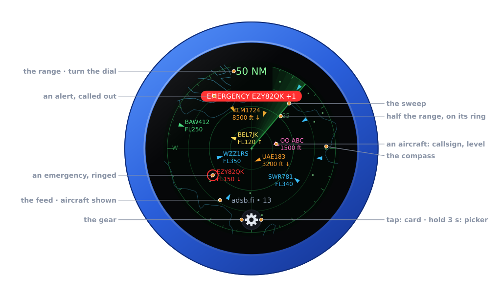

| Part | | |
|---|---|---|
| **The range** | turn the dial | across the radar, edge to edge from the middle: **50 NM**; **MIL** or **INT** beside it with the filter on |
| **The rings** | — | a quarter, half and three quarters of the range; half of it written on its ring |
| **The compass** | — | a tick each 10°, longer every 30° and 90°; E and W at the edge |
| **The map** | — | coasts and borders, and the airports as dots, the nearest named where there is room |
| **The aircraft** | tap: its card | arrows along their track, labelled nearest first where there is room |
| **The banner** | — | an emergency, or a type on your list: what, and which; **+2** for more |
| **The sweep** | — | goes round every 3.6 s, as on a radar's screen |
| **The feed** | — | where the aircraft come from, and how many are on the radar; what went wrong, in amber |
| **The gear** | tap: the address card · hold 3 s: the firmware picker | see [The gear](#the-gear) |
| **Battery** | — | the knob's own, under the range, while it runs on it |

There is no PTT, and no swipe does anything: the whole glass is the radar's.

## The range

Turn the knob: the next range, a detent each, with a click. In nautical
miles or miles: 5, 10, 20, 30, 50, 75, 100, 150, 200 and 250. In
kilometres: 10, 20, 40, 60, 100, 150, 200, 300, 400 and 450. The dial holds
at either end.

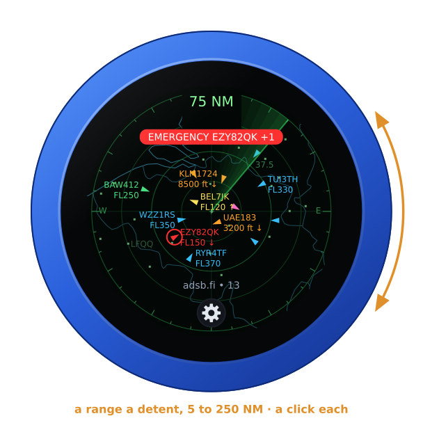

The map follows at once. Once the dial has rested for 0.6 s the knob keeps
that range and asks the feed for it straight away. After a restart the
range is where you left it.

Past 100 NM, the map shows the large airports alone:

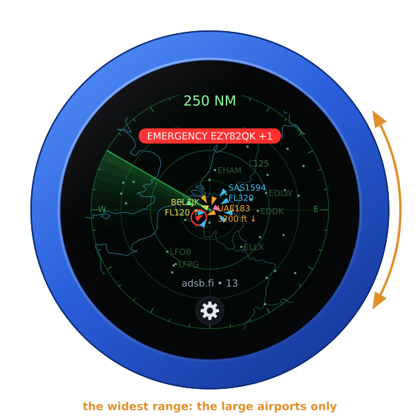

## The aircraft

Each aircraft is an arrow pointing along its track, or a small square when
the feed has no track for it. Its colour is its altitude:

| Altitude | Colour |
|---|---|
| on the ground, or none given | grey |
| under 2,000 ft | pink |
| under 10,000 ft | orange |
| under 20,000 ft | yellow |
| under 30,000 ft | green |
| under 40,000 ft | blue |
| 40,000 ft and up | violet |
| an emergency | red, with a red ring |
| a type on your list | gold |

The twelve nearest are labelled where there is room: the callsign (else the
registration, else the ICAO address), and the level — a flight level from
10,000 ft up, else feet — with an arrow when it climbs or descends more than
300 ft a minute. A label never covers another, nor the range, the banner or
the foot. An aircraft whose position is more than 20 s old is drawn dimmer.
Aircraft on the ground are left out unless the page asks for them.

## An aircraft's card

**Tap an aircraft**: its card. It shows the callsign, the type and
registration, the route, the level with its rate of climb or descent, the
speed and track, where it is from the middle, and its squawk. The aircraft
is ringed in white, and the sweep waits while the card is up.

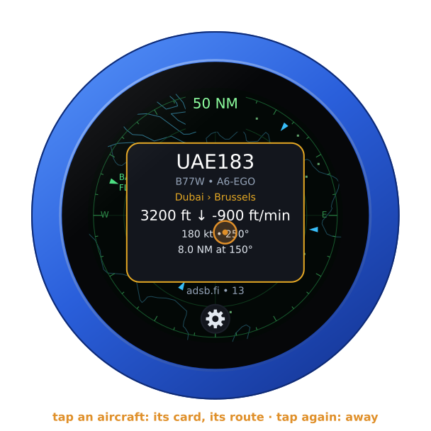

The route comes from [adsbdb](https://www.adsbdb.com), looked up by the
callsign the first time a card shows it (**route ...** while it is asked).
The knob keeps the last sixteen. An aircraft without a callsign, or one
adsbdb does not know, has no route.

Tap the card, or anywhere away from an aircraft, and it goes. On its own it
goes after 20 s, or when the aircraft leaves the feed.

## Alerts

An **emergency** — a squawk of 7500, 7600 or 7700, or the feed's own
emergency — is always shown, whatever the filter. It is red, ringed in red,
and called out at the top: **EMERGENCY**, **HIJACK**, **NO RADIO**,
**MEDICAL**, **MINIMUM FUEL** or **DOWNED**, with its callsign. The knob
buzzes once when one comes into range.

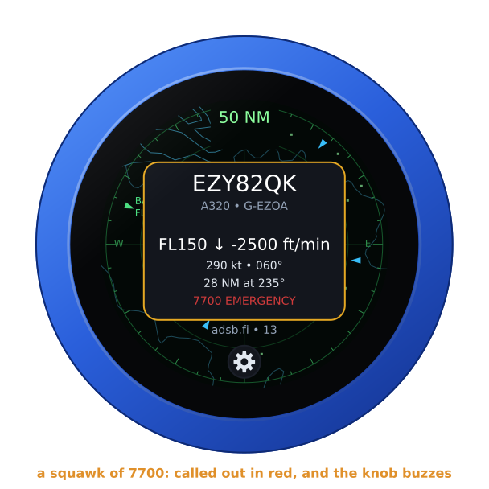

A **type on your list** (**Call out these types**) is gold, shown whatever
the filter, and called out at the top in gold on brown. The knob clicks once
when one comes into range. An emergency outranks a type in the banner; **+1**,
**+2** and so on count the other alerts on the radar.

## Show

**Military aircraft** or **interesting aircraft** shows those alone, as the
feed's database marks them; an emergency and a type on your list still show.
The range says which: **50 NM · MIL**, **50 NM · INT**.

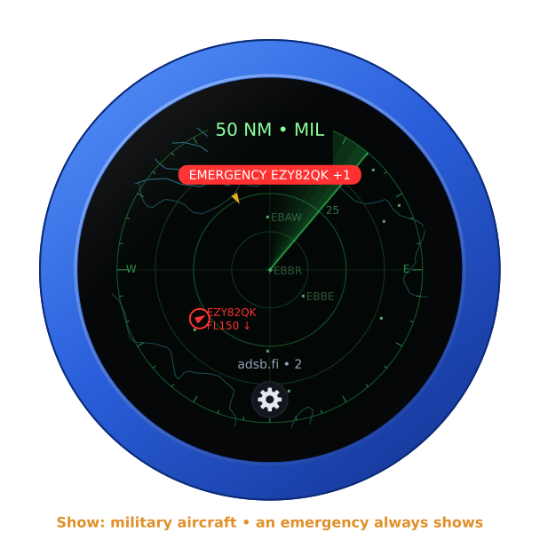

## The feeds

The three sites gather what receivers all over the world hear, and each
answers for the aircraft within the range of the middle; 250 NM is their
limit. airplanes.live answers **HTTP 403** until its people have been
written to (contact@airplanes.live, with what the project is); adsb.fi and
adsb.lol answer anyone. The knob asks every 10 seconds unless set otherwise,
and at once when the range or the settings change. While a feed fails, its
foot says why (**HTTP 429**, **no answer**, **no WiFi**) in amber, and the
last aircraft stay on the radar.

**Your own receiver** — readsb, dump1090 or tar1090 — is asked for its
`aircraft.json`, the whole of it; the knob keeps the 300 nearest within the
range.

## The gear

**Tap the gear**: the address card, with the firmware and its version, the
knob's power, and its addresses for the configuration page. Tap the gear
again, or the card itself, and it goes; on its own it goes after ten
seconds.

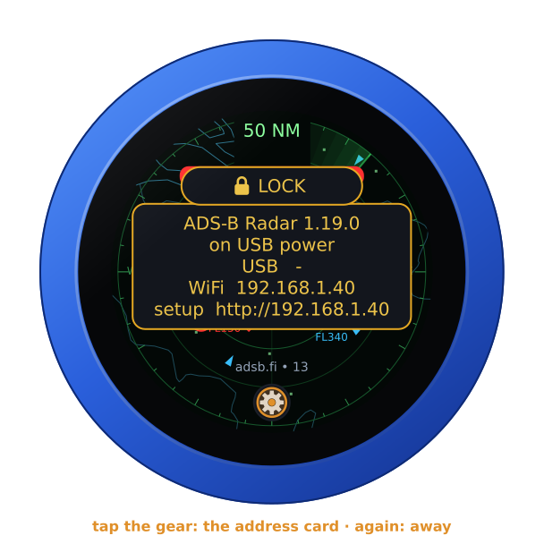

**Hold the gear for three seconds**, until the knob buzzes: it asks
**FIRMWARE?**. Turn the knob for yes, and it restarts into the setup
firmware's list, to install another firmware. A tap, or ten seconds of
nothing, says no.

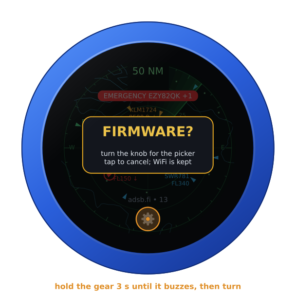

## On its own battery

Unplugged, the knob shows its charge under the range, as a phone does: full
to empty by the quarter, green from half its charge up, yellow under that,
red at a fifth and below. On USB power the charge cannot be read, and none
shows. The map leaves the top clear for it.

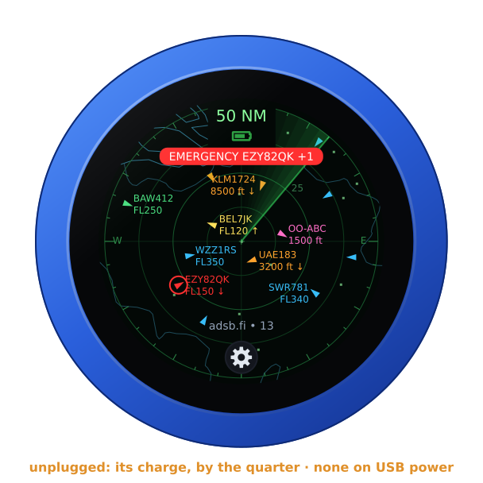

## The lock

The address card carries **LOCK**, as on every firmware: tap it, and the
knob is locked.

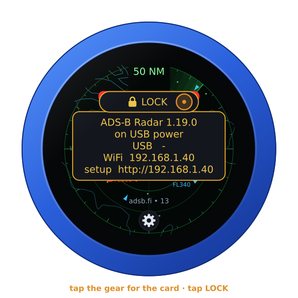

Locked, the padlock shows under the range. The dial and a tap on an aircraft
then do nothing, and the range stays where it is. The gear still brings the
card, with **UNLOCK** on it. A restart unlocks the knob too.

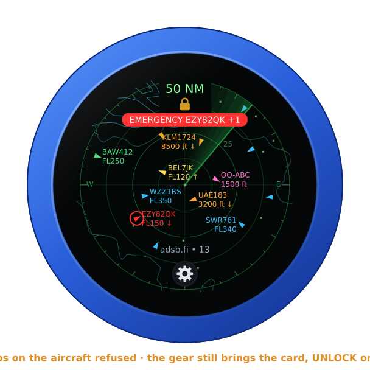

## Where it comes from

- The feeds, their fields and the altitude colours: Alex-developer's
  [ADSB-Radar](https://github.com/Alex-developer/ADSB-Radar), MIT, forked as
  [Guru-RF/ADSB-Radar](https://github.com/Guru-RF/ADSB-Radar).
- The aircraft: [adsb.fi](https://adsb.fi), [adsb.lol](https://adsb.lol)
  and [airplanes.live](https://airplanes.live), or your own receiver.
- The routes: [adsbdb](https://www.adsbdb.com).
- The map: [Natural Earth](https://www.naturalearthdata.com)'s coastlines
  and land borders, and [OurAirports](https://ourairports.com)' large and
  medium airports — both public domain, in the knob's image
  (`tools/adsb_tables.py`).
