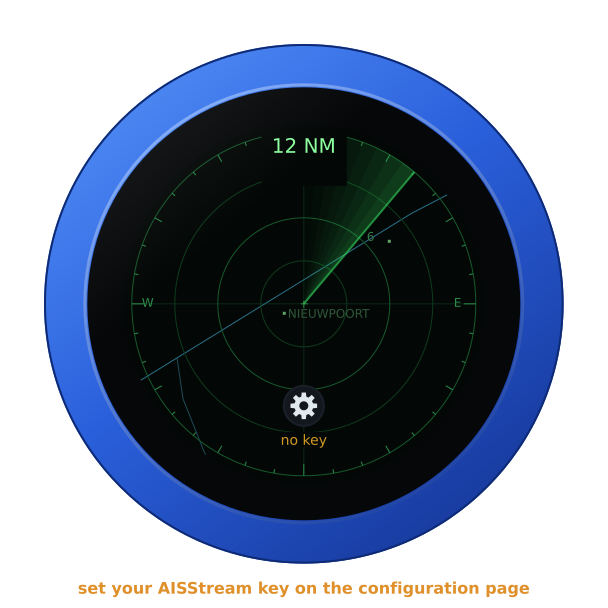
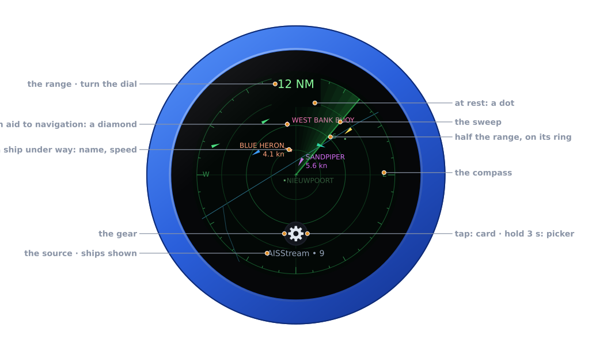
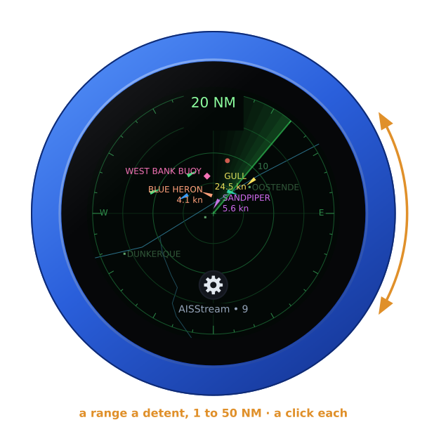
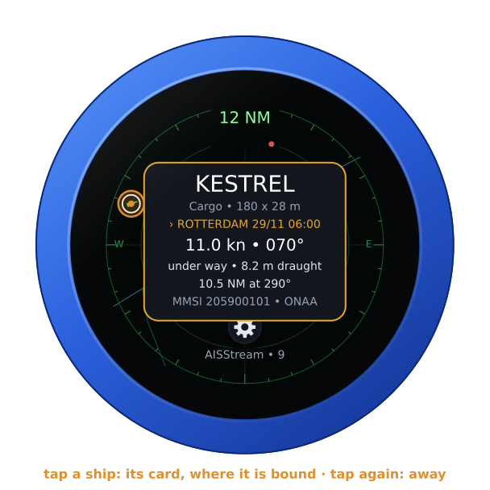
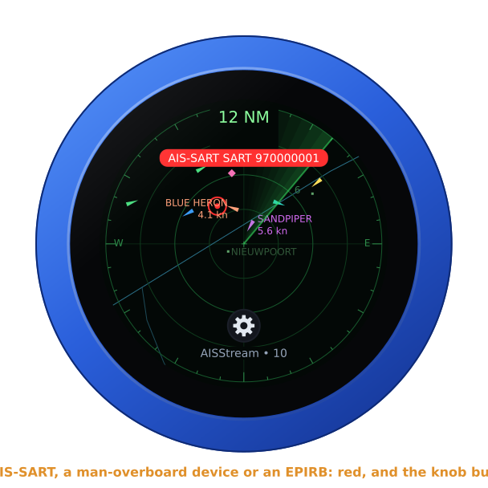
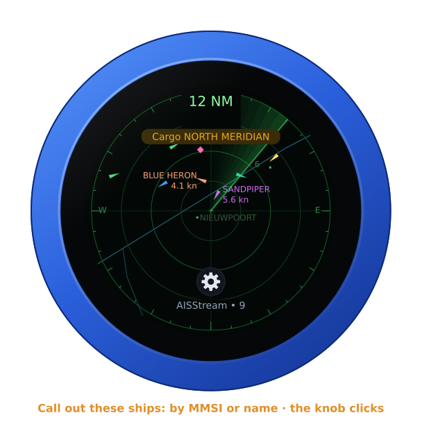
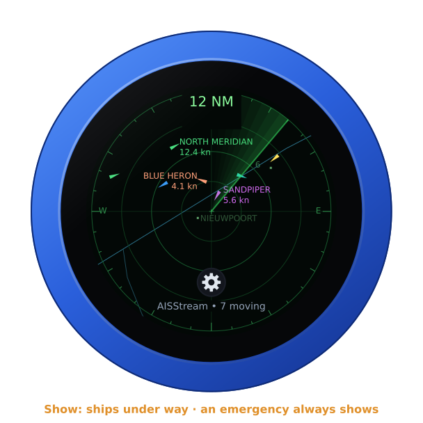
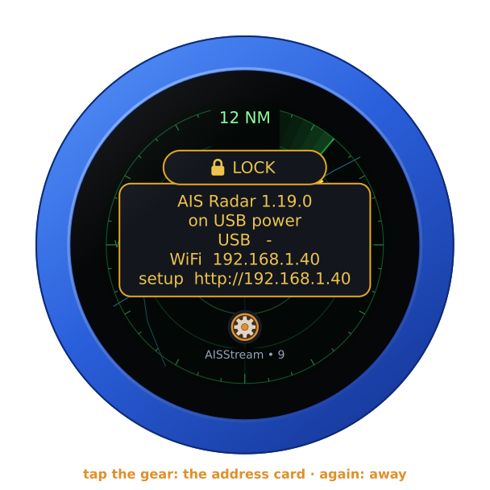
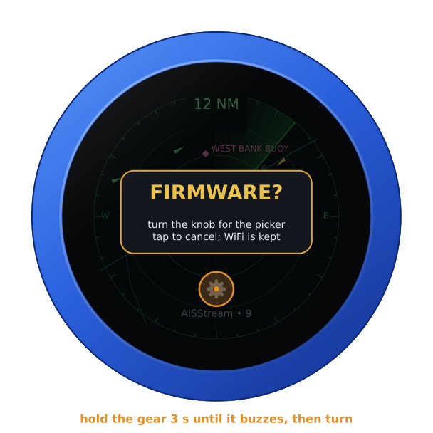

# The AIS Radar firmware

`vfo-knob-ais` turns the knob into a radar of the ships round you, as
[ADS-B Radar](adsb.md) is of the aircraft. North is up, the middle is a
harbour or a place you choose, and the dial sets the range. The ships come
from [AISStream.io](https://aisstream.io), with a free key of your own, or
from an [AIS-catcher](https://github.com/jvde-github/AIS-catcher) receiver
of yours. Each is an arrow along its course, coloured by its kind as the chart
plotters have them, and labelled with its name and speed. An AIS-SART, a
man-overboard device or an EPIRB is called out in red, and a ship you watch
for in gold. Tap a ship for its card: what it is, where it is bound, when.

The pictures are the knob's own screens, drawn from the firmware's texts and
layout (`tools/mkdocs.py`); the ships in them are made up. The orange marks
are what your hand does.

## First run

Install it from the setup firmware's list (**AIS Radar**, marked BETA), or
under **Firmware** on any firmware's configuration page — see
[the setup guide](setup.md). The knob needs WiFi with a way to the internet,
or to your own AIS-catcher.

Out of the box the middle is Westende, on the Belgian coast, and the ships
come from AISStream.io — which needs a key. Until it has one the foot says
**no key**, in amber.

AISStream's keys are free: sign in at [aisstream.io](https://aisstream.io)
with a GitHub account and make one under **API Keys**. Then open the knob's
configuration page: tap the gear for the address card (or hold a finger
anywhere on the radar until the knob clicks), and browse to the address on
it. The user is `admin` and the password `admin`. The page first asks for a
password of the knob's own, 8 to 32 characters, and shows nothing else until
it has one. Under **Radar**:

| Setting | |
|---|---|
| **Middle** | a harbour by its name, from the knob's own list of Natural Earth's ports; or a place, its latitude and longitude in degrees, north and east positive — your station's, say, or a stretch of coast. Left empty: **Westende** |
| **Ships from** | **AISStream.io** (a free key of your own) until set, or **your own AIS-catcher** |
| **Your AISStream API key** | pasted from aisstream.io. The knob keeps it on its SD card and never shows it again: the page says only that one is set. **Forget the key** removes it |
| **Your AIS-catcher's address** | its web server's, started with `-N 8100`: `http://192.168.1.20:8100` |
| **Distances in** | nautical miles, kilometres or miles |
| **Show** | every ship and aid to navigation; ships only; or ships under way |
| **Asked every** | how often your AIS-catcher is asked, 2 to 60 seconds; 5 until set. AISStream sends each ship as it is heard |
| **Harbours**, **Coasts and borders**, **The sweep** | on until turned off |
| **Call out these ships** | MMSIs or names, by comma: `205123000, PRINS FILIP, MSC*` — a `*` at the end for every name starting so |

**Save**, and the radar shows it at once. The page has no audio and no
Bluetooth for this firmware: the knob has no sound to give here.

## The face

| Part | | |
|---|---|---|
| **The range** | turn the dial | across the radar, edge to edge from the middle: **12 NM** |
| **The rings** | — | a quarter, half and three quarters of the range; half of it written on its ring |
| **The compass** | — | a tick each 10°, longer every 30° and 90°; E and W at the edge |
| **The map** | — | coasts and borders, and the harbours as dots, named where there is room |
| **The ships** | tap: its card | under way, an arrow along its course; at rest, a dot; an aid to navigation, a diamond; a base station, a square. Labelled nearest first where there is room: the name (or the MMSI, before the name has come), then the speed — or **moored**, **at anchor**, **aground**, **stopped** |
| **The banner** | — | an emergency, or a ship on your list: what, and which; **+2** for more |
| **The sweep** | — | goes round every 3.6 s, as on a radar's screen |
| **The gear** | tap: the address card · hold 3 s: the firmware picker | see [The gear](#the-gear) |
| **The foot** | — | under the gear: where the ships come from and how many are on the radar, with the filter — **AISStream • 9**, **your AIS-catcher • 4 moving**; what went wrong, in amber |
| **Battery** | — | the knob's own, under the range, while it runs on it |

The colours, by kind: cargo green, tanker red, passenger blue, high-speed
craft yellow, fishing salmon, pleasure craft violet, tugs, pilots and
the like (special craft) teal, aids to navigation pink, the rest grey. A
ship not heard for six minutes is drawn dimmed until it is heard again.

There is no PTT, and no swipe does anything: the whole glass is the radar's.
A finger held anywhere on it brings the address card, as the S-meter does on
a radio's face.

## The range

Turn the dial: a range a detent, with a click — 1, 2, 3, 5, 8, 12, 20, 30 and
50 NM (in kilometres 2 to 90, in miles alike). The coasts at the smallest
ranges are Natural Earth's at 1:50m, coarse next to a chart: the radar is for
what is round you, not for steering.

## A ship's card

Tap a ship: its card comes up over the radar, a ring round the ship. Its
name; its kind and size; where it is bound and when it means to be there, in
gold; its speed and course; its status and draught; how far, and which way;
its MMSI and call sign. Tap again, anywhere, and it goes.

## Alerts

An AIS-SART, a man-overboard device or an EPIRB — or a ship whose status
says AIS-SART active — is always shown, whatever the filter: ringed red on
the radar, called out at the top in red, and the knob buzzes.

A ship on your list (**Call out these ships**) coming into range is called
out at the top in gold, and the knob clicks.

## Show

**Ships only** leaves the aids to navigation and base stations out; **ships
under way** the ships at rest too. The filter's word follows the count at
the foot. An emergency shows whatever the filter.

## The gear

**Tap the gear** for the address card — the firmware, the knob's power and
its addresses, for the configuration page — with **LOCK** on it, as on every
firmware. Tap it again, or wait, and it goes.

**Hold the gear for three seconds**, until the knob buzzes: it asks
**FIRMWARE?**. Turn the knob for yes, and it restarts into the setup
firmware's list, the WiFi settings kept, to install another firmware. A tap,
or ten seconds of nothing, says no. With the card up, a finger held three
seconds anywhere on the radar does the same.

With the source down and its warning over the radar, hold the gear or the red
warning itself: the radar's holds do nothing then.

## On its own battery, and the lock

As on [ADS-B Radar](adsb.md#on-its-own-battery): the knob's charge, or a
green bolt on USB, under the range; **LOCK** on the address card, the
padlock under the range while locked, the dial and the taps on the ships
refused, and the gear still bringing the card with **UNLOCK**.

## Where it comes from

- The ships: [AISStream.io](https://aisstream.io), from receivers all over
  the world, with a key of your own; or
  [AIS-catcher](https://github.com/jvde-github/AIS-catcher) on a receiver of
  yours, its `/api/ships.json`.
- The radar: ADS-B Radar's, after Alex-developer's
  [ADSB-Radar](https://github.com/Alex-developer/ADSB-Radar).
- The map: [Natural Earth](https://www.naturalearthdata.com)'s coastlines,
  land borders and ports — public domain, in the knob's image
  (`tools/adsb_tables.py`, `tools/ais_tables.py`).
