# The Clock firmware

`vfo-knob-clock` turns the knob into a clock for the shack: local time on
the hands, UTC beside it, the date. There are four faces, and the dial goes
from one to the next. It keeps ten alarms. The time comes from the internet
over WiFi, so the knob needs no radio and no computer.

The pictures are the knob's own screens, drawn from the firmware's dials and
layout (`tools/mkdocs.py`); the orange marks are what your hand does.

## First run

Install it from the setup firmware's list (**Clock**), or under
**Firmware** on any firmware's configuration page — see
[the setup guide](setup.md).

Open the knob's configuration page: tap the glass for the address card, and
browse to the address on it. The user is `admin` and the password `admin`.
The page first asks for a password of the knob's own, 8 to 32 characters,
and shows nothing else until it has one. Under **Screen**:

- **Time zone**: where you are, Europe/Brussels until set. The page offers
  the browser's own zone; **Save** keeps it.
- **Hours**: 24-hour, or 12-hour with AM and PM, for the digital face.
- **Clock face**: the face the knob shows — the dial changes it too, and the
  one it rests on is kept.
- **Second hand**: on or off.

Under **Alarms**, the ten alarms, and how they ring — see
[the alarms](#the-alarms). Under **Bluetooth**, a headset or a speaker for
them to ring in. The knob plays nothing else: the page has no audio for this
firmware.

## The face

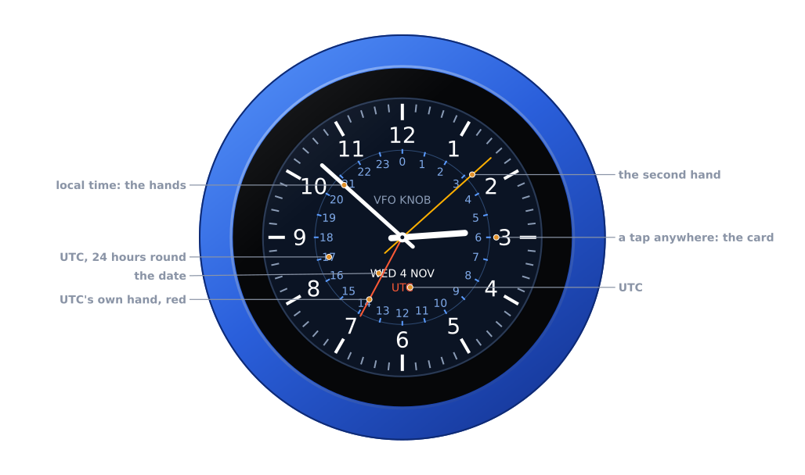

The **shack clock** is the first face. It is made for the radio room:

| Part | |
|---|---|
| **The hands** | local time, in the page's zone; the second hand in amber, ticking once a second |
| **The 24-hour ring** | UTC, 0 at the top and 12 at the bottom, inside the minute track |
| **The red hand** | UTC's own, on that ring: at 13:52 UTC it points just short of 14 |
| **The date** | the day, its number and the month, in local time |

There is no PTT, and no swipe does anything: the whole glass is the clock's.

## The faces

Turn the knob: the next face, a detent each, round and round. Once the dial
has rested for 0.6 s that face is kept, on the knob and on the page, and it
is there after a restart.

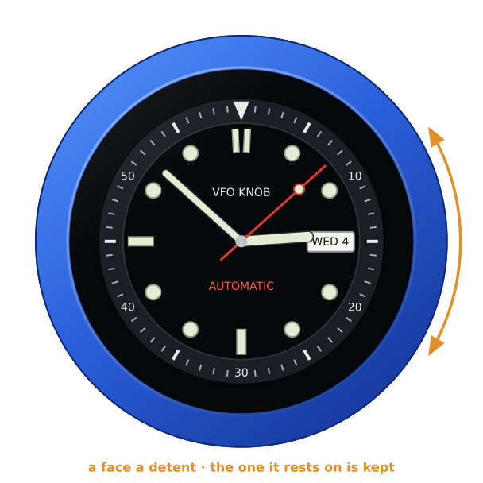

The **Diver**: a bezel marked to 60, lume dots and bars, the day and date in
a window at 3, and a red second hand that sweeps six steps a second, as a
diver's watch does.

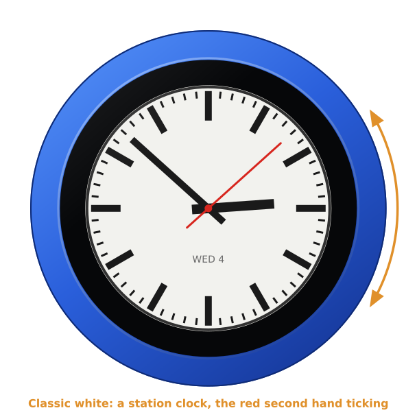

**Classic white**: a station clock, white with black bars, and a red second
hand that ticks.

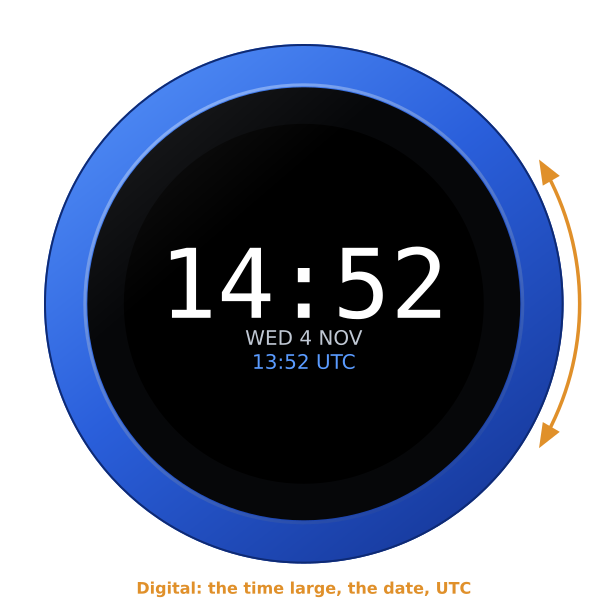

**Digital**: the time large, the colon blinking with the seconds, the date
and UTC under it. **Hours** on the page sets 24 or 12 hours.

With **Second hand: Off** the analog faces have hours and minutes only, and
the hands move once a minute.

## The time

The knob takes the time from the internet (pool.ntp.org) once it is on WiFi,
in UTC; the zone on the page is only how it is shown. Until the first
answer, the face has no hands and says so:

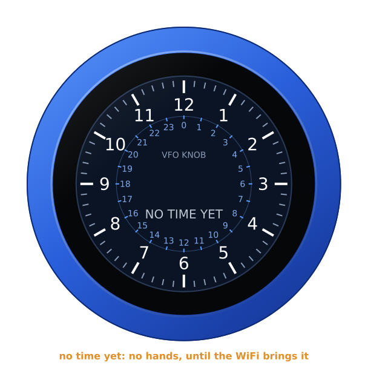

If the knob loses the internet, it keeps time on its own. Once the time is a
day without an answer, the hands and the digits turn grey: still near, but
not to be trusted to the second.

So that nothing stands still on the screen for days, the whole face moves a
pixel every three minutes, round a small square. You will not see it.

## The alarms

The knob keeps ten alarms, each with a time, the days it rings on, and on or
off. The next one to ring is on the dial, with a bell: its time, and its day
too when that is more than a day away.

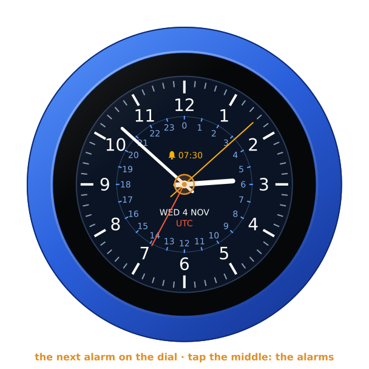

On the shack clock it stands where **VFO KNOB** does. The Diver has it under
**AUTOMATIC**, Classic white and Digital under the date.

**Tap the middle of the clock**: the alarms, one at a time, its number at
the top and ten dots round the glass, green for those on. It opens on the
next to ring. Turn the knob for the next alarm, round and round.

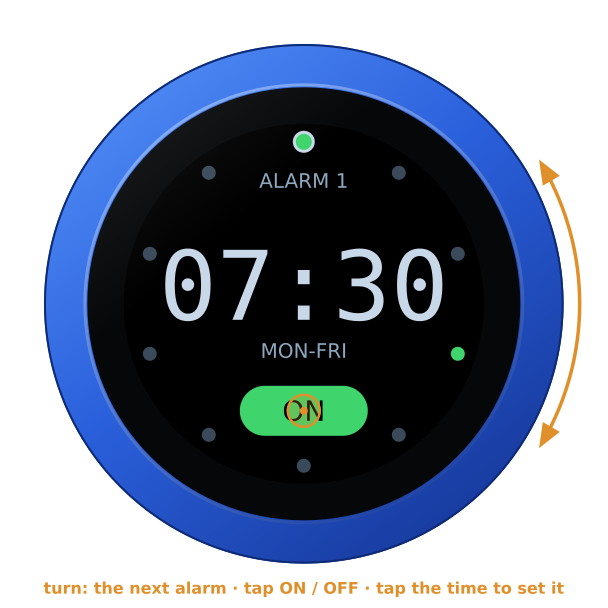

- **Tap ON or OFF** to switch the alarm.
- **Tap its time** to set it. The hours light up: turn the knob to set them,
  then tap. The minutes, the same, then tap. Then the days: turn through
  **ONCE**, **EVERY DAY**, **MON-FRI**, **SAT, SUN**, and each day alone,
  then tap. The alarm is kept, and on.
- **Tap anywhere else**, or leave it for 30 seconds, and the clock is back.
  An alarm half set stays as it was.

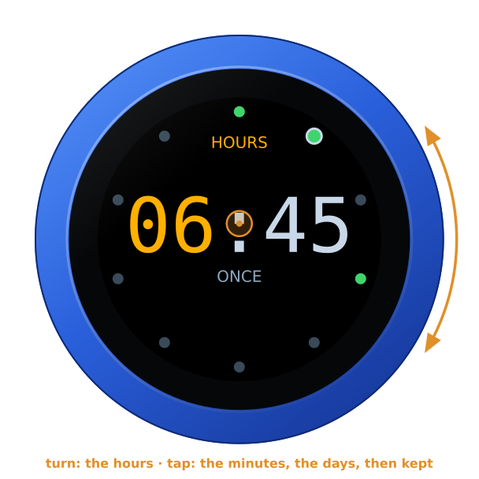

An alarm set **ONCE** rings the next time its time comes, and is then off.
The configuration page can set any days at all, Monday and Thursday say;
the knob shows them as **MO TH**.

### When one rings

The screen lights up whatever it was doing, the alarm's time large in a
flashing red ring. It rings with the motor, the sound, or both — both until
set on the page:

- **The motor** buzzes in pairs, over and over.
- **The sound** is beeps, four at a time, that grow louder: a third of the
  page's volume at first, all of it after 30 seconds. They play in a
  [Bluetooth headset or speaker](headset.md) while one is connected — its
  audio opens as the alarm starts, the jack playing the first second or so
  meanwhile, and closes as it stops — and on the jack, to headphones or a
  speaker there, while none is.

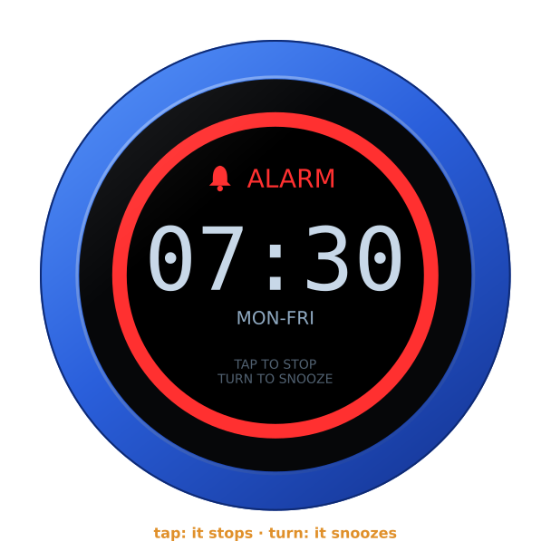

- **Tap**: it stops.
- **Turn the knob**: it snoozes, for 9 minutes until set. The dial then says
  when it rings again.

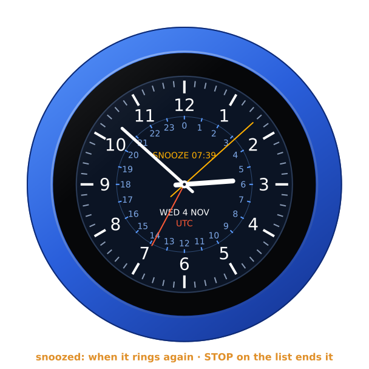

Left alone, it stops after 10 minutes, until set. A ringing alarm stops at a
tap and snoozes at a turn even with the knob locked.

To end a snooze early, tap the middle of the clock: the alarms open on the
snoozed one, its pill reading **STOP**. Tap it.

An alarm only rings once the knob has the time from the internet. Until
then the list says **NO TIME YET: NONE CAN RING**.

### On the page

Under **Alarms**, each alarm as a row: ticked to ring, its time, and its
days, none ticked for once. Under them:

- **Snooze**: 1 to 30 minutes, 9 until set.
- **Rings for**: 1 to 30 minutes, 10 until set.
- **Rings with**: the motor and the sound, the motor, or the sound; the
  motor and the sound until set.
- **The sound's volume**: 0 to 100 %, 60 until set. It is the knob's
  **VOLUME** on this firmware: the jack plays at it, and a Bluetooth speaker
  that takes its volume from what plays to it turns itself to it — its own
  buttons change nothing for long.

**Save** keeps the alarms as they are on the page. Anything set on the knob
since the page was opened is then lost, so reload the page first.

## Brightness and the screensaver

The Clock is a screen to look at, so it has no screensaver and never goes
dark until you set one on the page — see
[the screensaver guide](screensaver.md). **Brightness** on the page sets how
bright it is, 80 % until set.

## The address card

**Tap anywhere but the middle** of the glass: the address card, with the
firmware and its version, the knob's power, and its addresses for the
configuration page. Tap again, or wait ten seconds, and it goes.

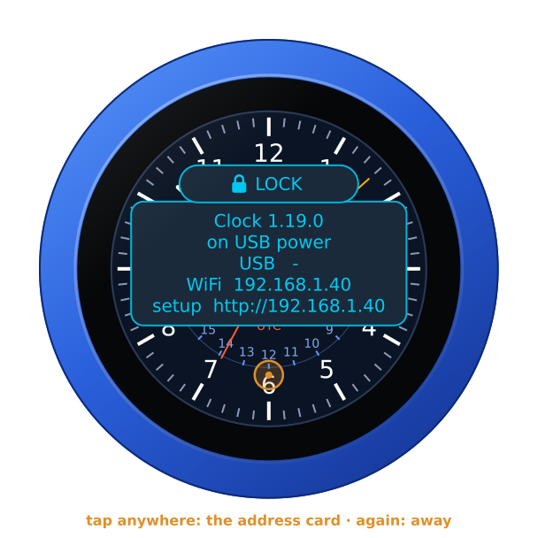

**Hold anywhere for three seconds**, until the knob buzzes: it asks
**FIRMWARE?**. Turn the knob for yes, and it restarts into the setup
firmware's list, to install another firmware. A tap, or ten seconds of
nothing, says no.

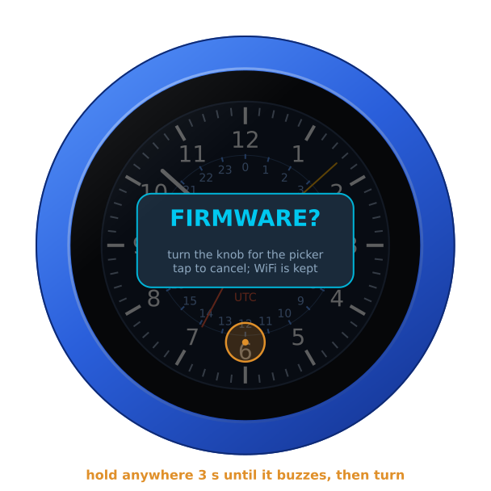

## On its own battery

Unplugged, the knob runs on its own battery. The clock shows the charge only
once it is low, a fifth or less, at the top of the face in red. The address
card always says which: **battery 85 %**, or **on USB power**.

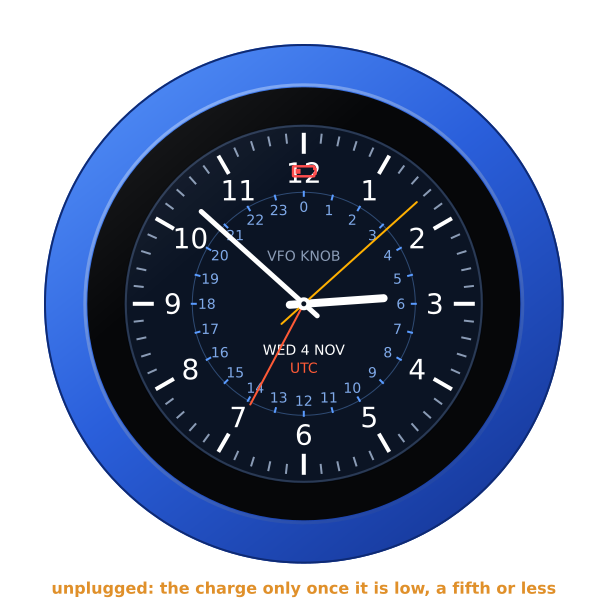

## The lock

The address card carries **LOCK**, as on every firmware: tap it, and the
knob is locked.

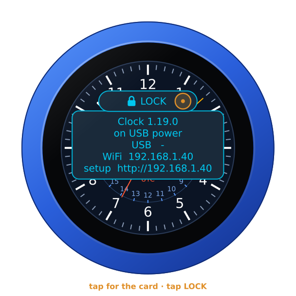

Locked, the padlock shows at the top, the dial changes no face, and the
middle opens no alarms. A tap still brings the card, with **UNLOCK** on it.
An alarm still rings, and stops at a tap. A restart unlocks the knob too.

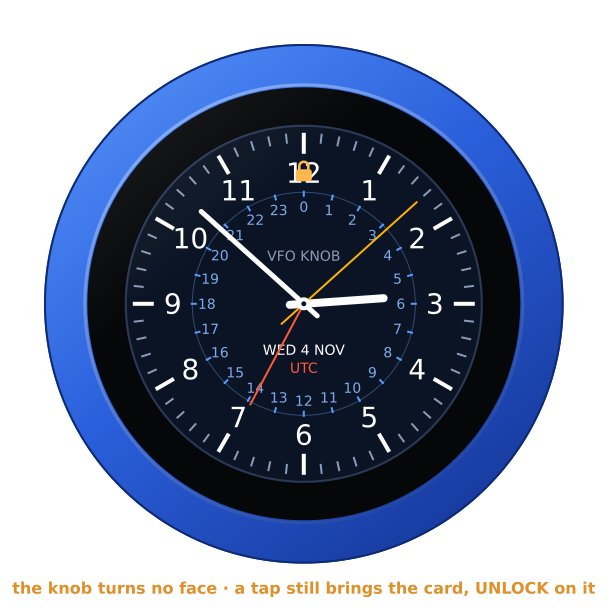

## Where it comes from

The faces are drawn by the knob's own code. They follow ideas from
MilovdZee's [Analog_Clock-esp32](https://github.com/MilovdZee/Analog_Clock-esp32)
(several faces; the hands greyed when the time is old) and Alan Wang's
[Saiko watch](https://github.com/alankrantas/saiko-iotomatic-watch-esp32-round-lcd)
(the diver's dial, its day-date window and its sweeping second hand). No
code or picture of theirs is in the firmware.
