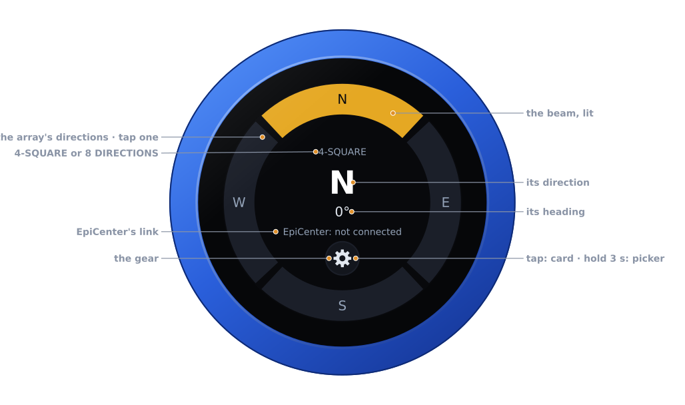
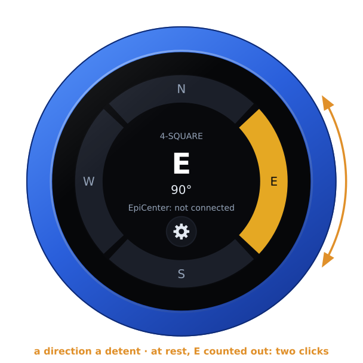
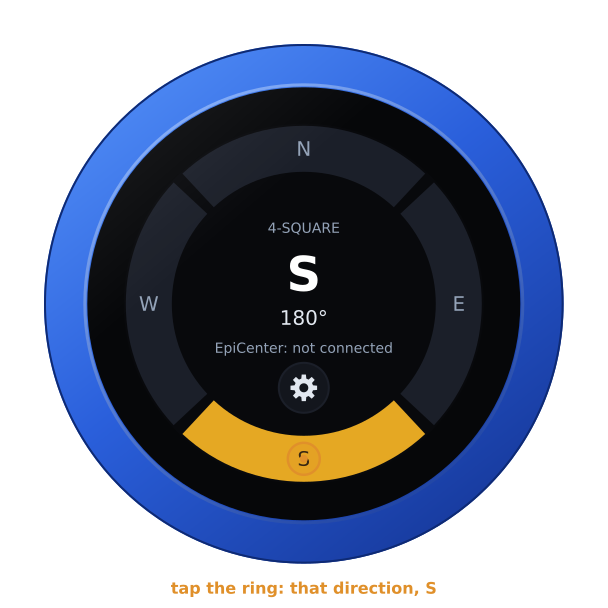
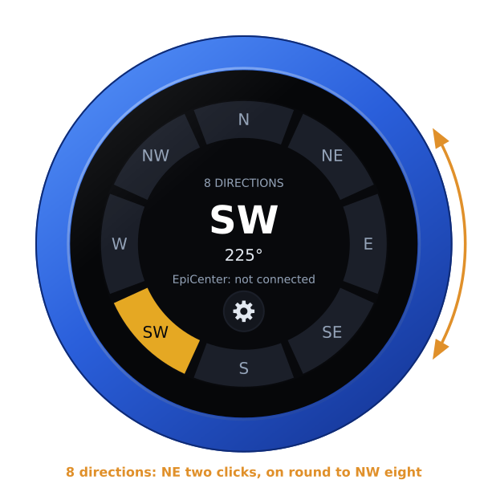
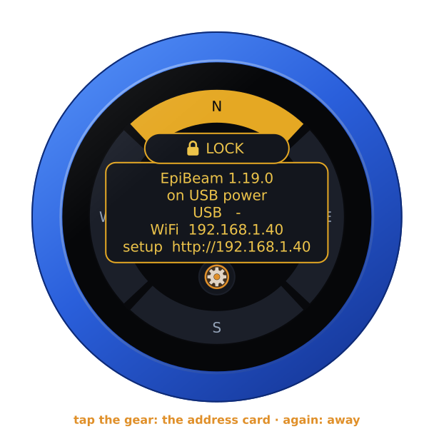
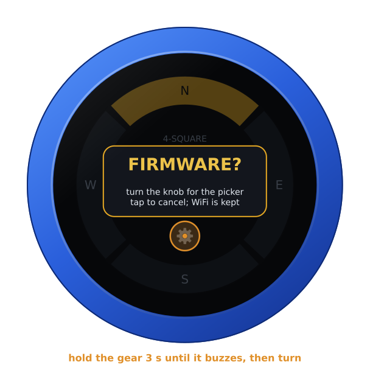
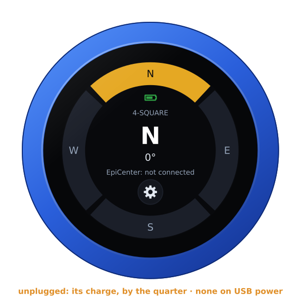
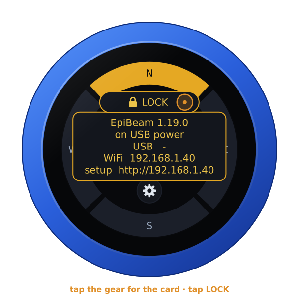
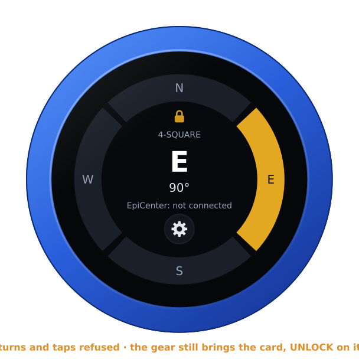

# The EpiBeam firmware

`vfo-knob-epibeam` turns the knob into the beam switch for a phased array: a
**4-square**, steered N, E, S or W, or an array of **8 directions** with the
corners between. The dial turns the beam a direction a detent, the knob
counts the direction out in clicks for a hand that is not looking, and the
beam goes to **EpiCenter**, the station's master — its central brain — which
switches the array.

**EpiBeam is a beta.** The setup firmware's list and the configuration page
say so. This first one is the knob's side only: it has no link to EpiCenter
yet. It keeps the direction you choose and says **EpiCenter: not connected**.

The pictures are the knob's own screens, drawn from the firmware's texts and
layout (`tools/mkdocs.py`); the orange marks are what your hand does.

## First run

Install it from the setup firmware's list (**EpiBeam**, stamped **BETA**),
or under **Firmware** on any firmware's configuration page — see
[the setup guide](setup.md).

Open the knob's configuration page: tap the gear for the address card, and
browse to the address on it. The user is `admin` and the password `admin`.
The page first asks for a password of the knob's own, 8 to 32 characters,
and shows nothing else until it has one. Under **Array**, choose the array:

- **4: N, E, S, W (a 4-square)**: the knob's choice until set.
- **8: N, NE, E, SE, S, SW, W, NW**.

Changing it keeps the beam on its heading. Going from 8 to 4, a corner goes
to the direction before it: NE to N, SE to E, SW to S, NW to W. The page has
no audio and no Bluetooth for this firmware, since the knob has no audio to
give here.

## The face

| Part | | |
|---|---|---|
| **The ring** | tap: that direction | the array's directions, the beam's lit in gold |
| **The array** | — | **4-SQUARE** or **8 DIRECTIONS**, as set on the page |
| **The beam** | — | its direction, large, and its heading under it: N 0°, E 90°, SE 135° |
| **EpiCenter** | — | **EpiCenter: not connected** for now; **EpiCenter**, in green, once the knob has its link |
| **The gear** | tap: the address card · hold 3 s: the firmware picker | see [The gear](#the-gear) |
| **Battery** | — | the knob's own, inside the ring, while it runs on it |

There is no PTT, and no swipe does anything: the whole glass is the beam's.

## Turning the beam

Turn the knob: the next direction, a detent each, round and round — past W
(or NW) to N again, and back. The ring and the middle follow at once.

Once the dial has rested for 0.4 s, that direction is taken. The knob counts
it out in strong clicks, a quarter of a second apart, so you know where the
beam is without looking:

| 4-square | | 8 directions | |
|---|---|---|---|
| **N** | 1 click | **N** | 1 click |
| **E** | 2 clicks | **NE** | 2 clicks |
| **S** | 3 clicks | **E** | 3 clicks |
| **W** | 4 clicks | **SE** | 4 clicks |
| | | **S** | 5 clicks |
| | | **SW** | 6 clicks |
| | | **W** | 7 clicks |
| | | **NW** | 8 clicks |

Turning on before the count has finished stops it: the knob counts the
direction it rests on next. Turned through several directions without a
rest, only the last is taken.

A tap on the ring goes straight to the direction under your finger, which
is taken and counted the same way. A tap nearer the middle does nothing.

On an array of 8 directions the ring has the corners too:

The knob keeps the direction: after a restart the beam is where you left it.

## The gear

**Tap the gear**: the address card, with the firmware and its version, the
knob's power, and its addresses for the configuration page. Tap the gear
again, or the card itself, and it goes; on its own it goes after ten
seconds. A tap on the ring beside it still turns the beam.

**Hold the gear for three seconds**, until the knob buzzes: it asks
**FIRMWARE?**. Turn the knob for yes, and it restarts into the setup
firmware's list, to install another firmware. A tap, or ten seconds of
nothing, says no. Holding the card, once it is up, does the same.

With a warning up (**NO SD CARD**, say), the warning panel shows the
addresses in the card's place: hold that three seconds for the picker.

## On its own battery

Unplugged, the knob shows its charge inside the ring, over the array, as a
phone does: full to empty by the quarter, green from half its charge up,
yellow under that, red at a fifth and below. On USB power the charge cannot
be read, and none shows. The address card says which: **battery 85 %**, or
**on USB power**.

## The lock

The address card carries **LOCK**, as on every firmware: tap it, and the
knob is locked.

Locked, the padlock shows inside the ring. The dial and the ring then steer
nothing, and the beam stays where it is. The gear still brings the card, with
**UNLOCK** on it. A restart unlocks the knob too.

## EpiCenter

EpiCenter is the station's master. It will take the beam from the knob over
a websocket, and switch the array. That link is still to come. Until then
EpiBeam keeps the beam and counts it out, but no relay moves, and the face
says **EpiCenter: not connected**. The knob's log (port 3333) shows each
direction as it is taken.
