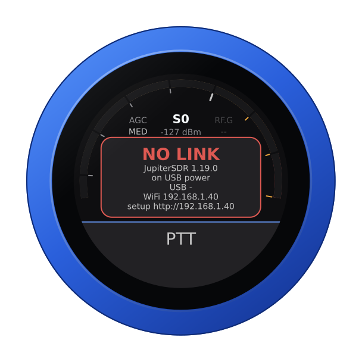
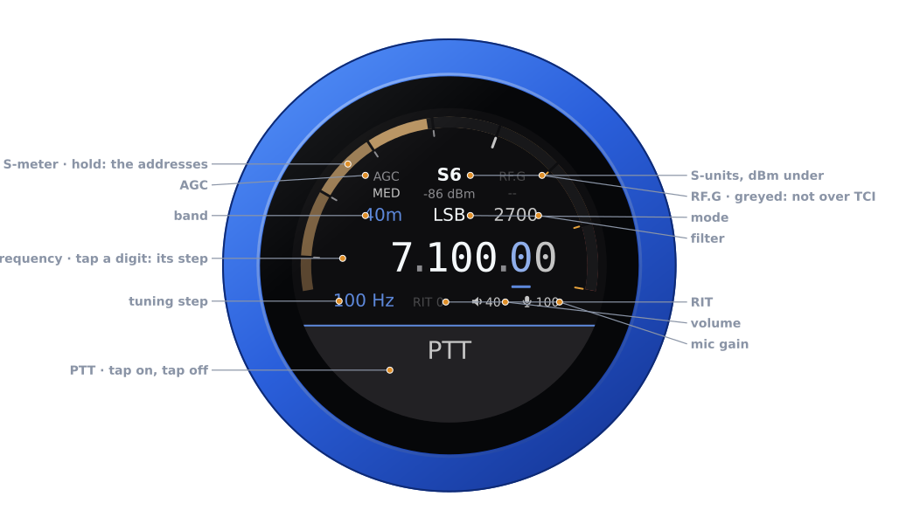
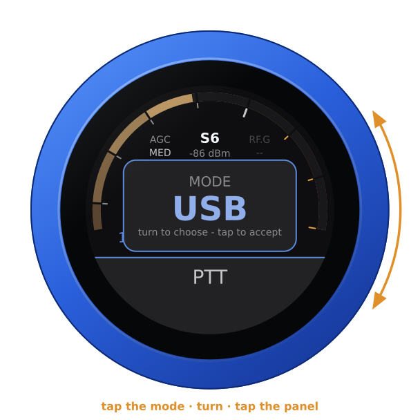
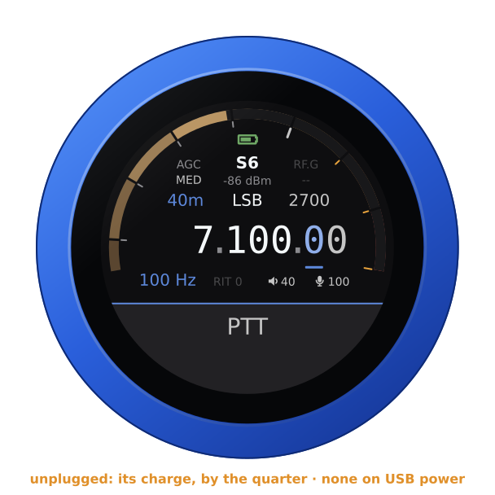
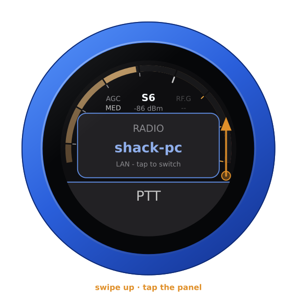
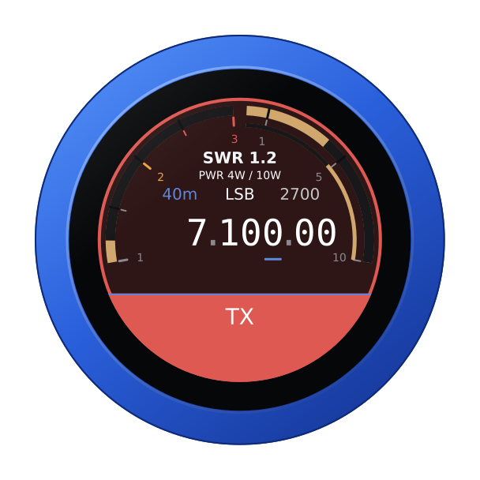
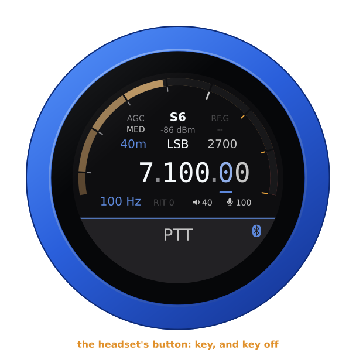
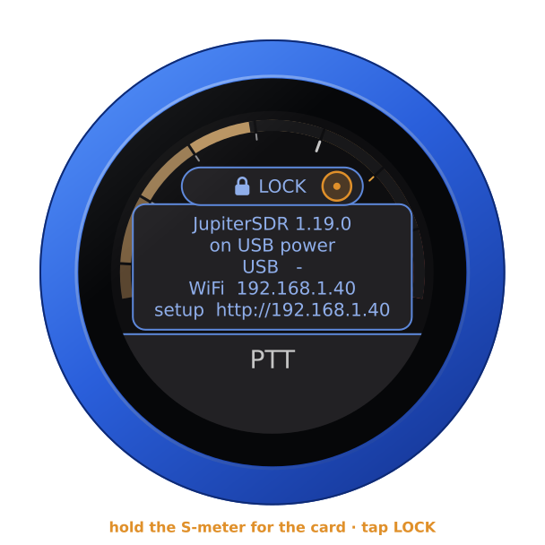
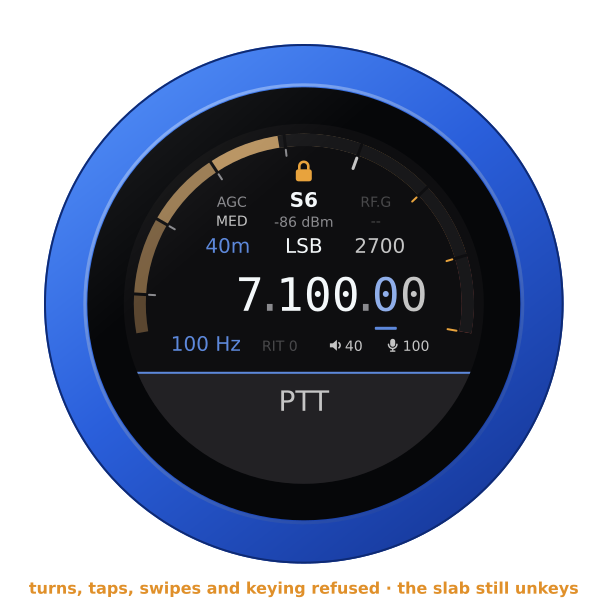

# The JupiterSDR firmware

`vfo-knob-jupitersdr`, a **beta**, is a client for
[Zeus SDR](https://zeussdr.com/). It talks to Zeus SDR's **TCI** server over
WiFi, as WSJT-X and other TCI programs do. Tune in Zeus SDR and the knob follows. Turn the knob and Zeus SDR moves.
Zeus SDR's audio plays on the knob's jack, and the knob's microphone goes back
to it. Its face wears Zeus SDR's colours: near-black, its blue for what is
selected, its S-meter's amber, and TX in its red. JupiterSDR is compatible
with ZeusSDR; it is not made by Zeus SDR's authors.

**Help wanted.** This beta has received through Zeus SDR on one station, and
has not yet been tried on the air through it. If you run Zeus SDR, please try
it and tell us what works and what does not: in
[GitHub issue #17](https://github.com/Guru-RF/VFO-Knob/issues/17), or with
**Report a problem** on the knob's configuration page.

The pictures are the knob's own screens, drawn from the firmware's texts and
layout (`tools/mkdocs.py`). The orange marks show what your hand does.

## With a FlexRadio

JupiterSDR keys and meters the radios Zeus SDR drives itself.
**With a FlexRadio**, use the [FlexRadio firmware](multiflex.md) instead,
beside Zeus SDR. Through *Zeus Link for Flex*, Zeus SDR's TCI server gives
receive audio and the frequency, but it refuses to key and sends no S-meter,
because there the radio belongs to Zeus Link, not to the part of Zeus SDR that
runs TCI. The FlexRadio firmware is a MultiFlex station of its own on the
radio, with its own slice, so it works alongside Zeus SDR.

## First run

1. In Zeus SDR, turn the **TCI** server on, and let it listen on the network
   (address `0.0.0.0`), not on its own computer alone. Its port is 40001.
2. Let that computer's firewall pass TCP port 40001 from your network. On
   Linux with ufw, for example:
   `sudo ufw allow from 192.168.1.0/24 to any port 40001 proto tcp`, with
   your own network in place of `192.168.1.0/24`.
3. Put the knob on the same network: see [the setup guide](setup.md). From
   the setup firmware's list, choose **JupiterSDR**, stamped **BETA**.
4. Zeus SDR announces nothing on the network, so give the knob its address.
   Hold the S-meter for the address card. It shows the knob's WiFi address:
   open that address in a browser. The user is `admin` and the password
   `admin`. The page first asks for a password of the knob's own, 8 to 32
   characters, and shows nothing else until it has one, since the knob can
   key a transmitter; your browser then asks for the new one. Under
   **Zeus SDR**, give the computer's IP address and port 40001. Up to four
   computers can be listed, each with a name for the dial.

Until Zeus SDR answers, the knob says so, with its addresses. Check that Zeus
SDR runs, that its TCI listens on the network, and that the firewall lets the
knob in.

## The face

| Part | Tap | |
|---|---|---|
| **S-meter** | hold: the address card, and **LOCK** | S-units of Zeus SDR's main receiver, peak held a second; dBm under the reading |
| **Battery** | — | the knob's own, over the reading, while it runs on it: full to empty by the quarter, green from half its charge up, yellow under that, red at a fifth and below. None on USB power, nor on the air |
| **AGC** | the AGC editor | FAST, MED, SLOW, LONG, FIXED: Zeus SDR's, with MEDIUM as MED. CUST shows when Zeus SDR is set to its custom AGC |
| **RF.G** | — | greyed: TCI does not carry the RF gain |
| **Band** | the band editor | the band's own frequency, on a tap on the panel |
| **Mode** | the mode editor | USB, LSB, CWU, CWL, AM, SAM, DSB, FM, DIGU, DIGL: Zeus SDR's own |
| **Filter** | the filter editor | its width, on the side of the carrier the mode uses |
| **Frequency** | a digit: the tuning step | the underlined digit is the step |
| **Step, RIT** | RIT: its editor | RIT in amber when set |
| **Volume, mic gain** | their editors | the knob's own levels |
| **PTT** | key, and key off | see [Transmitting](#transmitting) |

Turn the knob to tune: a slow turn moves a step at a time, and a flick crosses a
band. Band and mode change on a tap *on the panel*. Filter, AGC, RIT, volume
and mic gain apply as you turn, and any tap closes them.

Unplugged, the knob runs on its own battery and shows its charge at the top
of the arc, as a phone does. On USB power the charge cannot be read, and none
shows. The address card says which: **battery 85 %**, or **on USB power**.

## Another computer

With more than one computer listed, swipe up, turn to one, and tap the panel.
The knob then restarts into that one.

## Transmitting

**PTT** is a toggle: tap to key, tap again to unkey. It keys as the finger
lifts from a tap, so a swipe that starts on it never keys. On the air, a
touch unkeys at once.

The knob's microphone is the radio's microphone while you are keyed. Its
audio goes to Zeus SDR over TCI. Zeus SDR decides whether to transmit, as it
does for its own MOX button: it refuses outside the bands it allows. When
Zeus SDR refuses a key, the knob buzzes the refusal and stays in receive.
The face turns to transmit:

- SWR across the left half;
- forward power across the right, on a scale that follows the power: 10 W,
  100 W or more;
- the knob's microphone level on the thin inner ring.

**When the link drops**, Zeus SDR does not unkey by itself. The knob sends the
unkey again as soon as it is back. Until then Zeus SDR's own transmit timeout
ends the over, after two minutes unless you set it otherwise. Keep that
timeout on.

## A Bluetooth headset

With the companion firmware on the knob's second chip, a Bluetooth headset can
be the knob's ear and microphone, and its call button the PTT: a press keys,
the next unkeys. The slab keeps PTT, with the headset's logo at its right
end. The logo is red while the headset has its microphone muted: then neither
its button nor the slab keys. The knob's own microphone is off while the
headset is connected. The headset's battery shows beside the logo in green,
yellow or red, where the headset reports it
([its battery](headset.md#its-battery)). For pairing, the companion firmware
and using the boom arm as the PTT, see [the headset guide](headset.md).

A Bluetooth speaker plays the knob's audio along with the jack, and you
transmit with the knob's own microphone: see
[the guide](headset.md#a-bluetooth-speaker).

## Locking the knob

Hold the S-meter for the address card, let go, and tap **LOCK**, which has
come up over the S-meter. A padlock shows at the top of the arc. A turn tunes
nothing, a tap or a swipe opens nothing, and nothing keys: not the slab, nor a
headset's button or its boom arm. Unkeying is never locked: on the air, a tap
on the slab or the headset's button still unkeys. The padlock goes red for a
moment when it refuses something. A question the knob asks still takes its
answer.

To unlock, hold the S-meter again and tap **UNLOCK**. With no link it is over
the warning. A restart unlocks too.

| The card's LOCK | Locked |
|---|---|
|  |  |

## Another firmware

Hold the S-meter for the address card. Then hold it again for three seconds,
until the knob buzzes, and turn: see
[the setup guide](setup.md#back-to-the-setup-firmware-from-any-radios).
