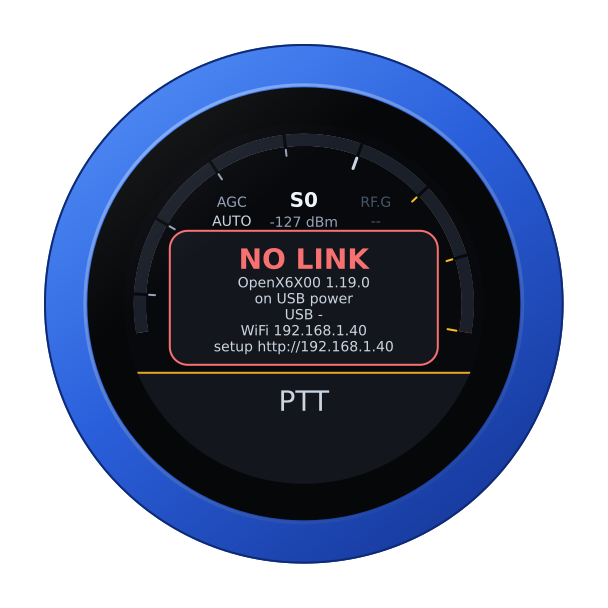
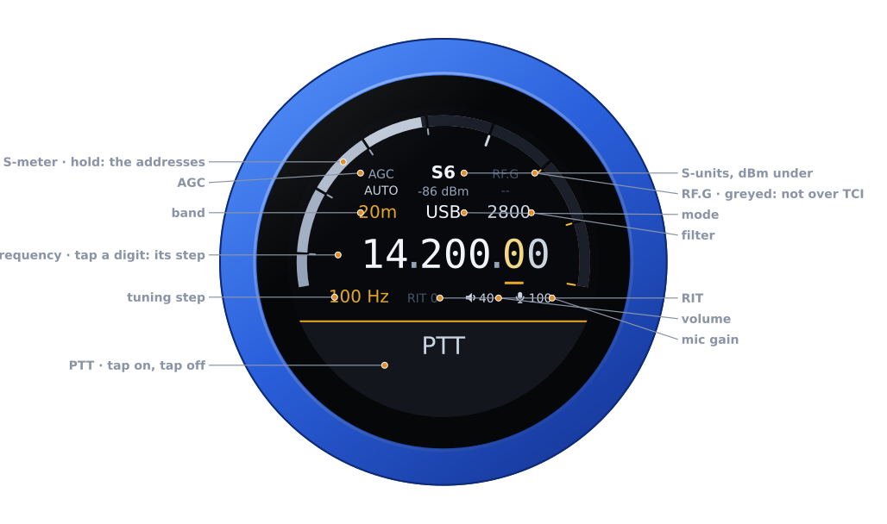
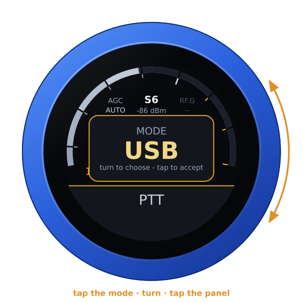
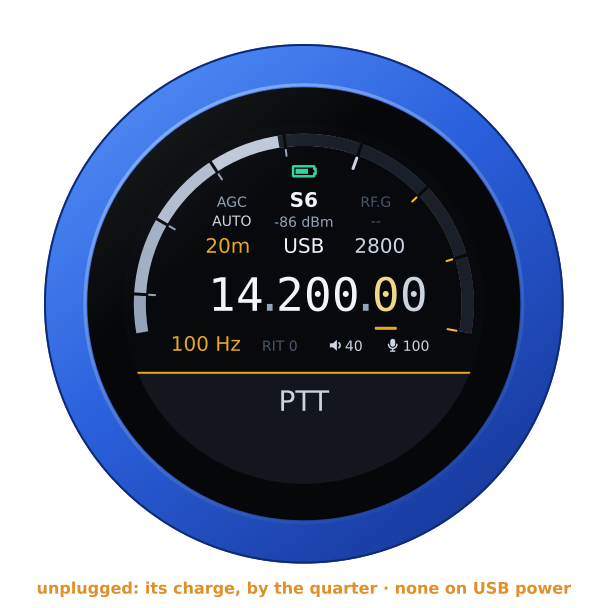
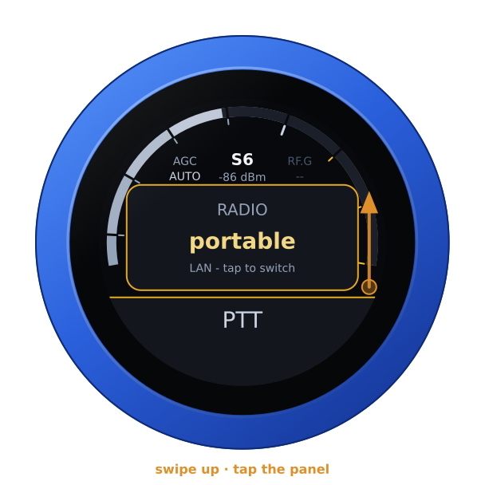
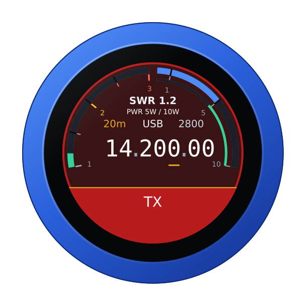
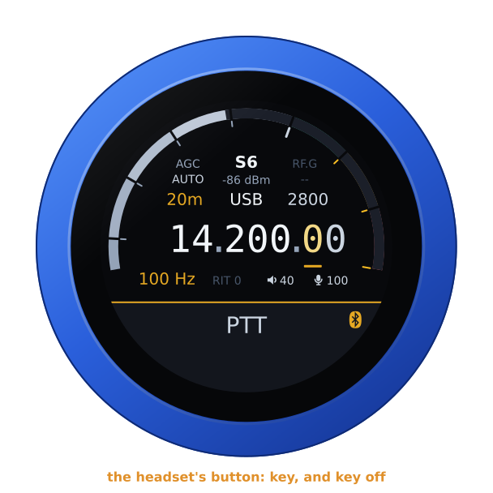

# The OpenX6X00 firmware

`vfo-knob-openx6x00` is a dial for a Xiegu X6100 running
[OpenX6X00](https://github.com/Guru-RF/OpenX6X00), the radio's open firmware.
It talks to the radio itself over WiFi, through the radio's **TCI** server,
with no computer in between. Tune on the radio and the knob follows. Turn the
knob and the radio moves. The radio's audio plays on the knob's jack, and the
knob's microphone goes back to the radio. Its face wears OpenX6X00's RF.Guru
colours: near-black, gold for what is on, and power in blue.

The pictures are the knob's own screens, drawn from the firmware's texts and
layout (`tools/mkdocs.py`). The orange marks show what your hand does.

## First run

1. On the radio, the TCI server is on by default. Check it under
   *Settings → General → TCI SERVER*, or under *System → TCI* on the radio's
   web page, `http://x6100.local/`. Its port is 50001.
2. Put the knob on the same network as the radio: see
   [the setup guide](setup.md). From the setup firmware's list, choose
   **OpenX6X00**.
3. The knob looks for the radio as **`x6100.local`**, the name OpenX6X00
   announces on the LAN, so a radio on its default name needs nothing set.
   When its IP address changes, the knob finds it again by that name.

To open the configuration page, hold the S-meter for the address card. It
shows the knob's WiFi address: open that address in a browser. The user is
`admin` and the password `admin`. Change the password: the page nags until
you do, since the knob can key a transmitter.

If you renamed the radio (*Settings → Wireless → NETWORK NAME* in
OpenX6X00), give the knob that name followed by `.local`, or the radio's IP
address. Up to four radios can be listed, each with a name for the dial.

Until the radio answers, the knob says so, with its addresses. Check that the
radio is on, on the same network, and has its TCI server on.

## The face

| Part | Tap | |
|---|---|---|
| **S-meter** | hold: the address card | S-units, peak held a second; dBm under the reading |
| **Battery** | — | the knob's own, over the reading, while it runs on it: full to empty by the quarter, green from half its charge up, yellow under that, red at a fifth and below. None on USB power, nor on the air |
| **AGC** | the AGC editor | AUTO, FAST, SLOW, OFF |
| **RF.G** | — | greyed: TCI does not carry the RF gain |
| **Band** | the band editor | the band's own frequency, on a tap on the panel |
| **Mode** | the mode editor | USB, LSB, CW, CW-R, AM, NFM, DIGU, DIGL |
| **Filter** | the filter editor | its width, on the side of the carrier the mode uses |
| **Frequency** | a digit: the tuning step | the underlined digit is the step |
| **Step, RIT** | RIT: its editor | RIT in amber when set |
| **Volume, mic gain** | their editors | the knob's own levels |
| **PTT** | key, and key off | see [Transmitting](#transmitting) |

Turn the knob to tune: a slow turn moves a step at a time, and a flick crosses a
band. Band and mode change on a tap *on the panel*. Filter, AGC, RIT, volume
and mic gain apply as you turn, and any tap closes them.

Unplugged, the knob runs on its own battery and shows its charge at the top
of the arc, as a phone does. On USB power the charge cannot be read, and none
shows. The address card says which: **battery 85 %**, or **on USB power**.

## Another radio

With more than one radio listed, swipe up, turn to one, and tap the panel.
The knob then restarts into that radio.

## Transmitting

**PTT** is a toggle: tap to key, tap again to unkey. It keys as the finger
lifts from a tap, so a swipe that starts on it never keys. On the air, a
touch unkeys at once.

The knob's microphone is the radio's microphone while you are keyed. Its
audio goes to the radio over TCI. The face turns to transmit:

- SWR across the left half;
- forward power across the right, on the radio's 10 W scale;
- the knob's microphone level on the thin inner ring.

The radio guards the transmitter itself, even if the knob or the WiFi fails.
It unkeys:

- after half a second without the knob's audio;
- when the knob's link drops;
- after three minutes on the air.

## A Bluetooth headset

With the companion firmware on the knob's second chip, a Bluetooth headset can
be the knob's ear and microphone, and its call button the PTT: a press keys,
the next unkeys. The slab keeps PTT, with the headset's logo at its right
end. The logo is red while the headset has its microphone muted: then neither
its button nor the slab keys. The knob's own microphone is off while the
headset is connected. The headset's battery shows beside the logo in green,
yellow or red, where the headset reports it
([its battery](headset.md#its-battery)). For pairing, the companion firmware
and using the boom arm as the PTT, see [the headset guide](headset.md).

A Bluetooth speaker plays the knob's audio along with the jack, and you
transmit with the knob's own microphone: see
[the guide](headset.md#a-bluetooth-speaker).

## Another firmware

Hold the S-meter for the address card. Then hold it again for three seconds,
until the knob buzzes, and turn: see
[the setup guide](setup.md#back-to-the-setup-firmware-from-any-radios).
