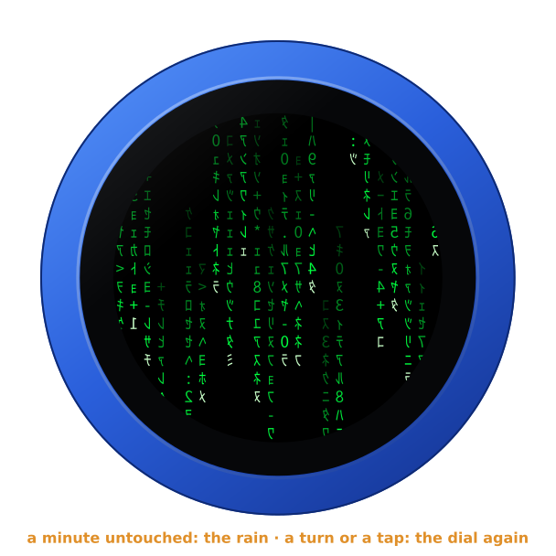
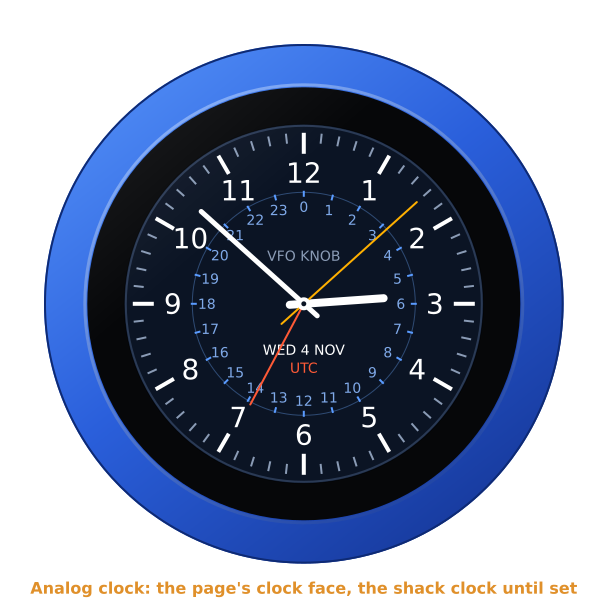
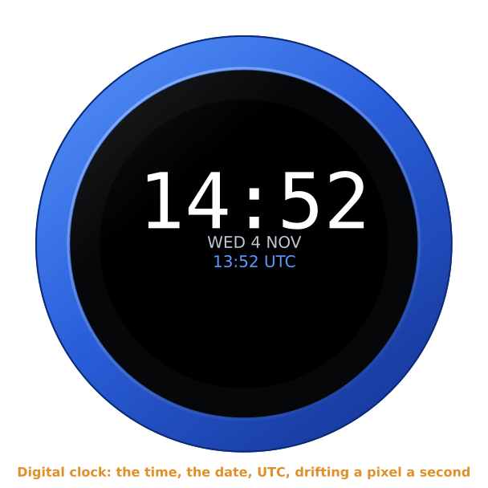
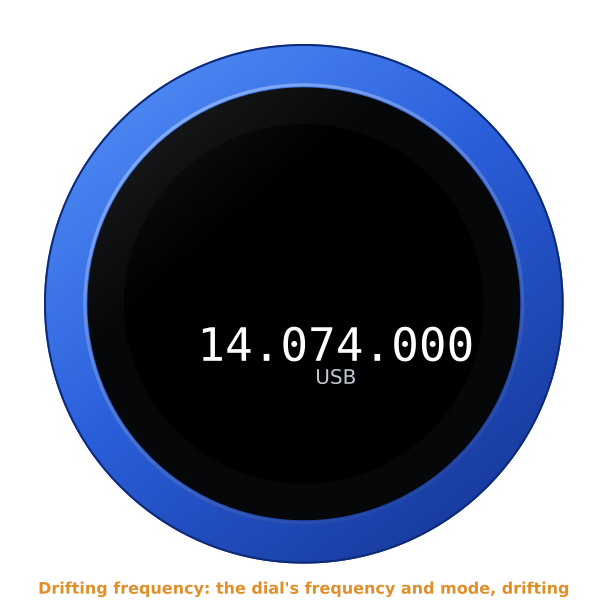
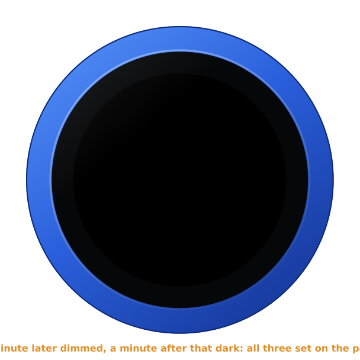

# The screensaver

Every firmware has a screensaver. Left alone, the knob shows it, then dims
it, then lets the screen go dark, so that the dial does not stand still on
the screen for hours. A turn or a touch brings the dial back.

The pictures are the knob's own screens, drawn from the firmware's savers
(`tools/mkdocs.py`).

## When it comes

On every firmware but the Clock, the Weather and the WiFi Test, until set:

1. **A minute** with nothing done: the screensaver, at full brightness.
2. **A minute later**: dimmed.
3. **A minute after that**: dark.

Turning the knob, touching the screen and transmitting all count as use, and
start the minutes again. So does anything the knob asks you, and a call on
the Telephone, from its first ring to its end: a call ringing in brings the
dial back by itself.

The first turn or touch on a screensaver or a dark screen only brings the
dial back: it does not tune, key or tap whatever was under your finger. The
next one does.

The **Clock**, the **Weather** and the **WiFi Test** are screens to look at:
theirs is **None** and never dark, until set.

## The settings

Under **Screen** on the configuration page:

| Setting | |
|---|---|
| **Screensaver** | Matrix rain, Analog clock, Digital clock, Drifting frequency, or None |
| **Screensaver after** | minutes with nothing done, 0 for never |
| **Dim after** | minutes more, 0 for never |
| **Go dark after** | minutes more, 0 for never |
| **Brightness** | the screen's while it is lit, 10 to 100 %, 80 % until set; dimmed, it is dimmer |

Each time counts from the one before it. With **None** the dial itself stays
up, and dims and goes dark at the same moments. A knob whose owner had set
**Dim after** and **Go dark after** before the screensaver came keeps those
moments: the screensaver from the old dim time, dimmed a minute later, dark
at the old dark time.

The clocks follow **Time zone** and **Hours** on the same page, and the
**Clock face** set there.

## Matrix rain

The default. Columns of green characters fall, each at its own speed, a pale
head and a trail that fades, the characters mirrored as in the film.

## Analog clock

The clock face set on the page: the shack clock, with UTC on its 24-hour
ring, until set; or the Diver or Classic white. The faces are
[the Clock firmware's](clock.md).

## Digital clock

The time large, the date and UTC under it, moving a pixel a second round the
glass and bouncing off its edge.

## Drifting frequency

What the dial shows largest, drifting the same way: on a radio the frequency
and the mode, or the memory channel; on SVXConnect the talk group and the
reflector; on the Telephone the favourite on the dial; on EpiBeam the beam's
direction and heading; on ADS-B Radar its range; on the Clock the time and
the date; on the Weather the temperature and the sky in words; on the WiFi
Test the signal, in dBm and in a word.

## The time

The knob takes the time from the internet (pool.ntp.org) once it is on WiFi,
in UTC; on the AetherSDR firmware's cable, once the computer passes it on
([the internet over the cable](aethersdr.md#the-internet-over-the-cable)). Until the first answer, the clocks say **NO TIME YET**. Without an
answer for a day, they turn grey.

## Dark

The screen off. A turn or a touch lights it, and the dial is back as it was.
