# The TailChaser firmware

`vfo-knob-tailchaser` turns the knob into a remote for
[TailChaser](https://github.com/Guru-RF/TailChaser) repeaters, over their own
API: it watches them, plays what they transmit, and blocks their receiver
or transmitter. The knob itself never transmits. It reaches each repeater
over the LAN, over the internet, or over your own tailnet
([Tailscale](https://tailscale.com/)), so from anywhere the knob has WiFi.
It wears [SVXConnect](svxconnect.md)'s face and colours.

The pictures are the knob's own screens, drawn from the firmware's texts and
layout (`tools/mkdocs.py`); the orange marks are what your hand does.

## What it needs

- One or more TailChaser nodes: a transmitter, a duplex repeater or a
  simplex node. A split repeater is read at its transmit site. The knob
  asks each node's status page, on port 8080 unless you give another.
- An API key per node, made in the node's admin portal
  (`http://<node>:8080/admin`, **API keys**). A read key only watches; a
  control key may also block the repeater.
- To hear a repeater: `[status] monitor = true` in its `tailchaser.conf`.
  Without it the knob shows the repeater but plays nothing.
- To reach the repeaters from outside their network: a Tailscale account
  that has them on its tailnet.

## First run

Open the knob's configuration page: hold a finger on the S-meter until the
knob clicks, and browse to the address on the card. The user is `admin`,
the password `admin`. The page first asks for a password of the knob's own,
8 to 32 characters, and shows nothing else until it has one.

1. Set the WiFi.
2. Under **TailChaser**, **Repeaters**, add each repeater: its address as
   the knob reaches it, its API key, and the name the knob shows for it.
   - The address is a name on your tailnet (such as `on0ora-tx`), an IP
     address, or a name the DNS knows; with `:port` when its status page is
     not on 8080.
   - The name is at most 16 characters, such as `ON0ORA-S` for a simplex
     node beside the repeater. Left empty, the repeater's callsign is shown.
   - The dial steps through them in this order.
3. For repeaters on your tailnet, tick **Reach the repeaters over my
   tailnet** (see [Tailscale](#tailscale)).
4. **Save**. The knob restarts and reads every repeater at once.

The API keys and the auth key are kept on the knob, never shown again, and
leave it only in the requests to the repeaters and to Tailscale.

## Tailscale

The knob joins your tailnet as a device of its own, as a phone or a laptop
does, and finds the repeaters there by their names. It joins one of two
ways:

- **An auth key.** On Tailscale's
  [Keys page](https://login.tailscale.com/admin/settings/keys), **Generate
  auth key**, with **Reusable** left off. Paste it under **Auth key** and
  save.
- **A login.** Leave the auth key empty and save. After the restart the page
  shows a login address: open it and log in to Tailscale to add the knob.

Once the knob shows on the tailnet, turn off its key expiry, or it has to
log in again after half a year. On the
[Machines page](https://login.tailscale.com/admin/machines), click the knob,
then **Machine settings** (the gear, top right) and **Disable key expiry**.

Tailscale is started once each time the knob starts: a change to it takes a
restart. Each repeater is first reached through one of Tailscale's relays,
and directly a few seconds later, when the networks between allow it. The
page's status says which: **directly**, or **through a Tailscale relay**,
which is slower. **Forget this knob's Tailscale identity** makes the knob
join as a new device at the next start.

## The face

The radio face, read for a repeater:

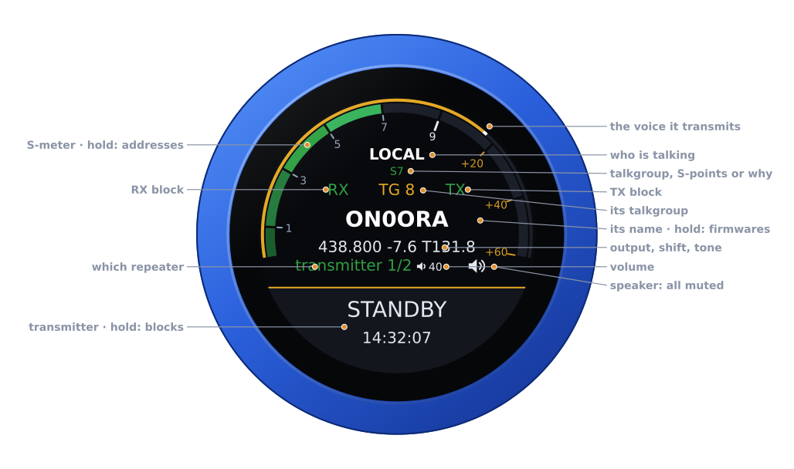

| Part | Tap | |
|---|---|---|
| **The arc** | hold: the address card, and **LOCK** | the repeater's receiver: its signal in S-points, on the repeater's own scale, as its status page has it |
| **The thin gold line** | — | outside the arc: the level of what the repeater transmits, as the knob plays it |
| **Who is talking** | — | the talkgroup's talker, **LOCAL** for a voice on its input, **CARRIER** for a signal with no voice; under it the talkgroup, the S-points or why the repeater is on the air. Quiet: who spoke last, and how long ago |
| **RX, TX** | — | the blocks: green open, red blocked, grey while the repeater is not being read |
| **Talkgroup** | — | the talkgroup the repeater's link is on |
| **Name** | hold 3 s: the firmware picker | the repeater's name, its output frequency, shift and tone under it |
| **Which repeater** | — | its kind and its place on the dial: **transmitter 1/2** |
| **Volume** | its editor | the knob's own |
| **Speaker** | muted, and back | every repeater muted, and kept so through restarts |
| **The slab** | hold: the blocks | the repeater's transmitter: **STANDBY**, **TX** in red while it is keyed, **TX BLOCKED**; the time under it |

The time under the slab is the knob's local time, to the second, from the
internet; dashes until it has been told.

Unplugged, the knob runs on its own battery and shows its charge at the top
of the arc, over who is talking, as a phone does. On USB power the charge
cannot be read, and none shows.

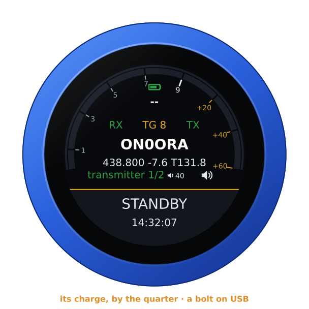

## The repeaters on the dial

Turn the knob: the next repeater, one a detent; the dial stops at the first
and the last with a click. Every repeater is read all the time, a few times
a second, so a turn shows the next one at once.

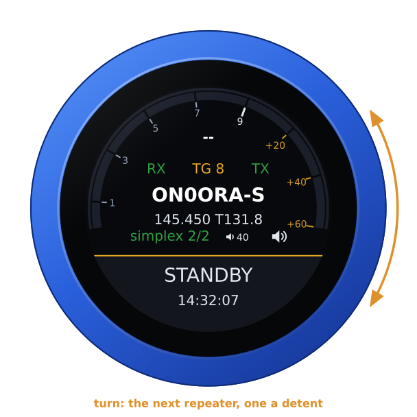

When another repeater becomes busy (a talker on its talkgroup, or a voice
on its input) the knob goes to it by itself. It waits until the one shown
has been quiet, and the knob left alone, for the time set under **Show the
busy one after** (20 s; 0: only the dial moves it). An announcement or a
carrier with no voice is not busy. While the one shown is busy the knob
stays, so two repeaters answering each other are not bounced between.

## Who is talking

A talker on the talkgroup is shown as long as the repeater sends their
over. TailChaser sends the talker's call in Morse first and keeps the voice
waiting meanwhile, and then its tail: a short over is still on the air
seconds after the talker has stopped, and the knob shows them until the
transmitter drops.

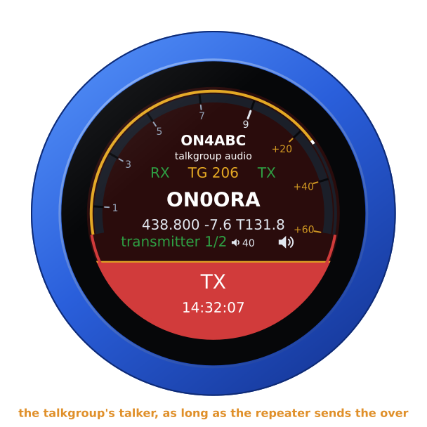

A voice on the repeater's own input is **LOCAL**, its signal on the S-meter
and in S-points under it. A signal that holds the squelch open with no voice
is **CARRIER**.

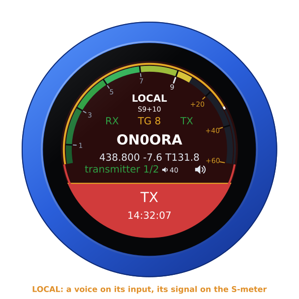

When it is quiet, who spoke last, and how long ago. An over too short for
the knob to see, between two reads, is still found in the repeater's
history.

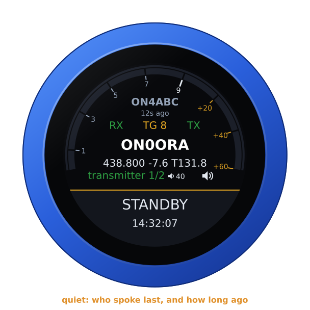

## Listening

The knob plays what the repeater it shows transmits: on the jack, and on a
Bluetooth headset or speaker. Only the one shown is played, and turning to
another plays that one. A simplex node does not transmit what it receives,
so the stations on its input are shown, not heard: its own status page's
**Listen** card plays its receiver.

Tap the volume to set it: turn, and tap to accept.

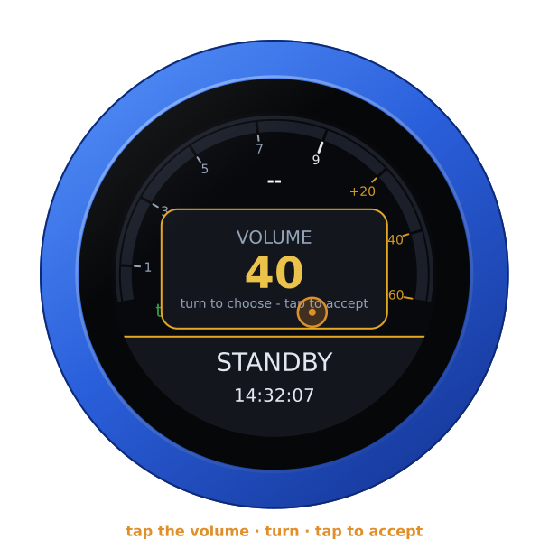

Tap the speaker to mute every repeater, and again to hear them. The knob
keeps it muted through restarts. The thin gold line still shows what the
repeater transmits.

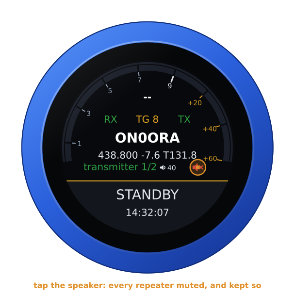

A Bluetooth speaker connected shows as a speaker at the slab's right end,
in gold: the repeater plays on it. See
[A Bluetooth headset or speaker](headset.md).

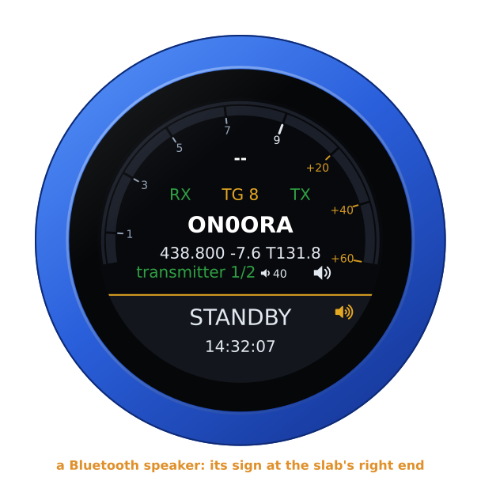

## Blocking

A block stops the repeater's receiver (**RX**: nothing it hears is passed
on) or its transmitter (**TX**: it keys for nothing). It stays on the
repeater, through its restarts and power cuts, until it is released: on the
knob, on the configuration page, or in the repeater's own admin portal.
Blocking needs a control key.

Hold **STANDBY**: the menu for the repeater shown. Turn between **RX** and
**TX**; a tap blocks it, or opens it again. Each says how it stands, green
open, red blocked.

A blocked transmitter shows **TX** in red and **TX BLOCKED** on the slab; a
blocked receiver, **RX** in red.

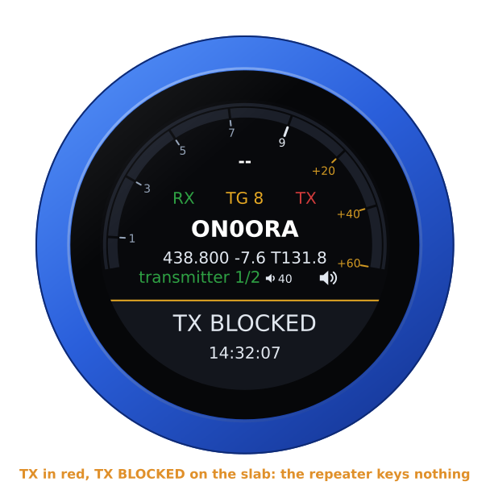

What the knob says when a block is not made:

| | |
|---|---|
| **READ-ONLY KEY** | the key only watches: a control key blocks |
| **KEY REFUSED** | the repeater does not know the key |
| **NO KEY** | no key is set for it |
| **NOT CONNECTED** | the repeater is not being read |
| **NOT DONE** | the repeater did not answer the request |

## When a repeater does not answer

**NO LINK** shows when the repeater shown has not answered for 5 seconds.
Its address and why are on the face, and on the configuration page's
status. The knob keeps asking. A reply that stalls halfway is given up
after a second and a half and asked again on a new connection.

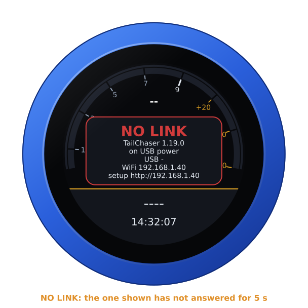

With **NO REPEATERS**, none is set: add them on the configuration page.

## Lock

With the address card up, tap **LOCK**: the knob ignores turns, taps and
swipes until **UNLOCK** on the card again, or a restart.

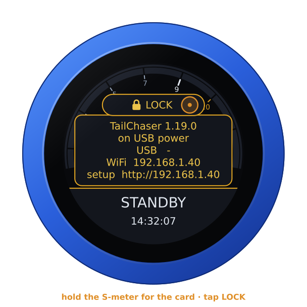

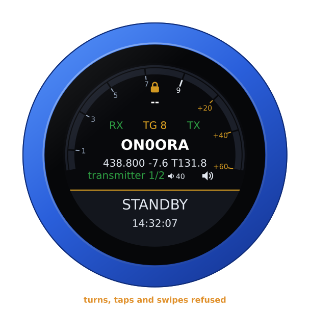

## Kept

The repeaters and their names, the keys, the hold, the muted speaker, the
volume and the repeater shown, across a restart. The screensaver is every
firmware's: see [the screensaver guide](screensaver.md).
