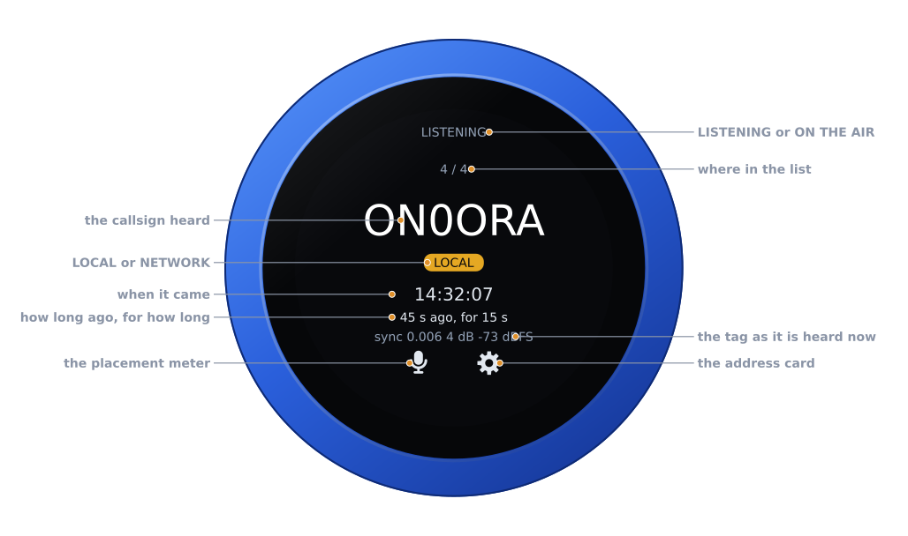
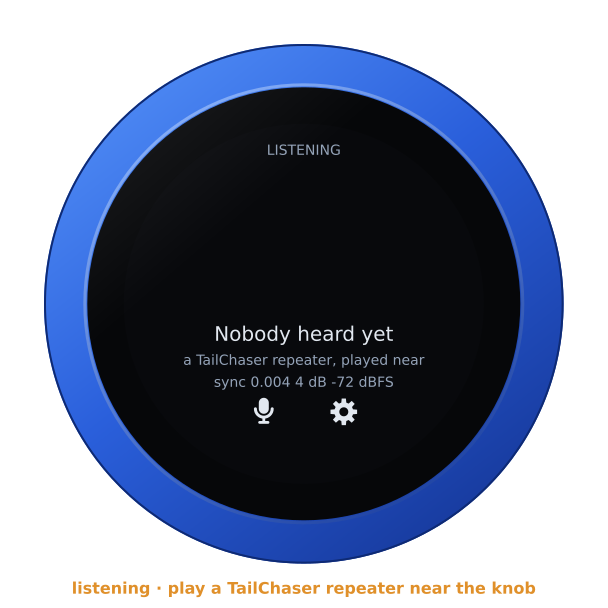
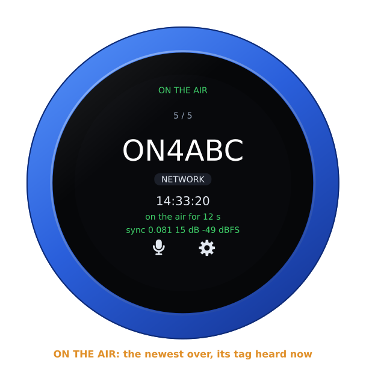
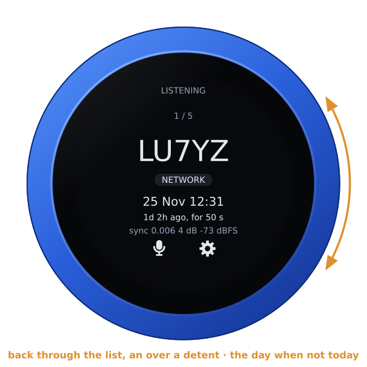
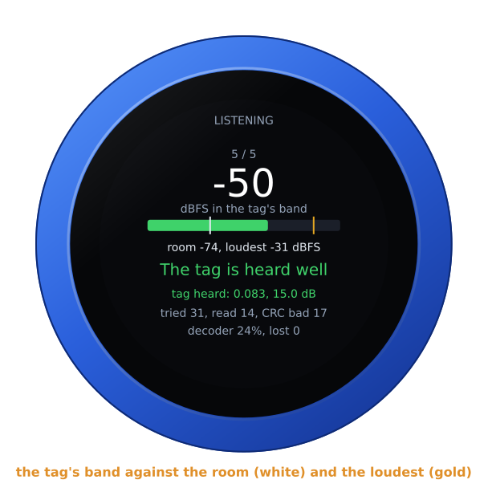
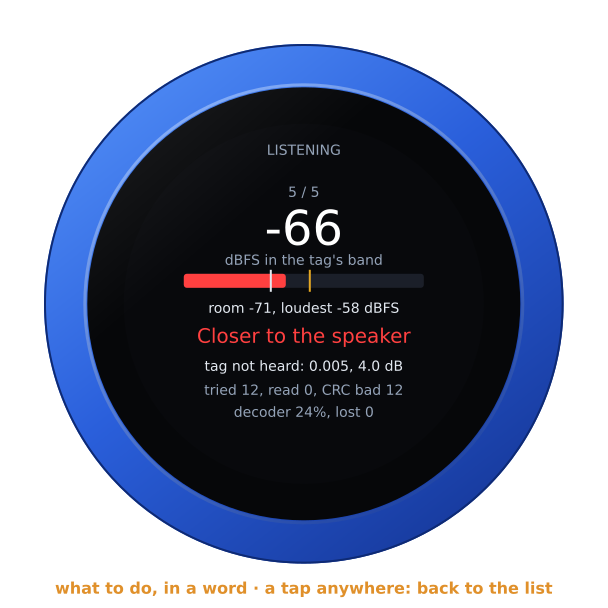
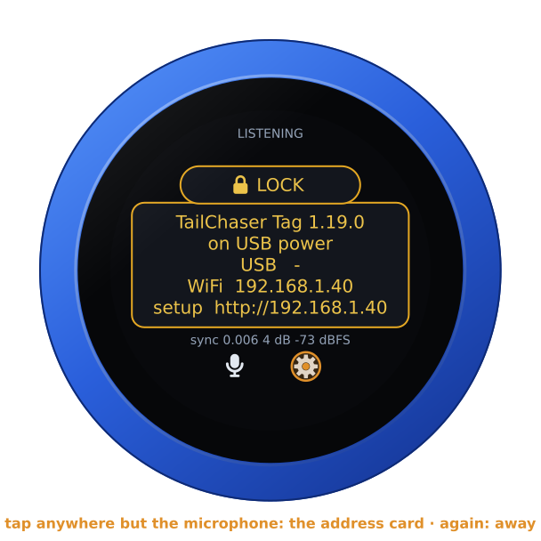
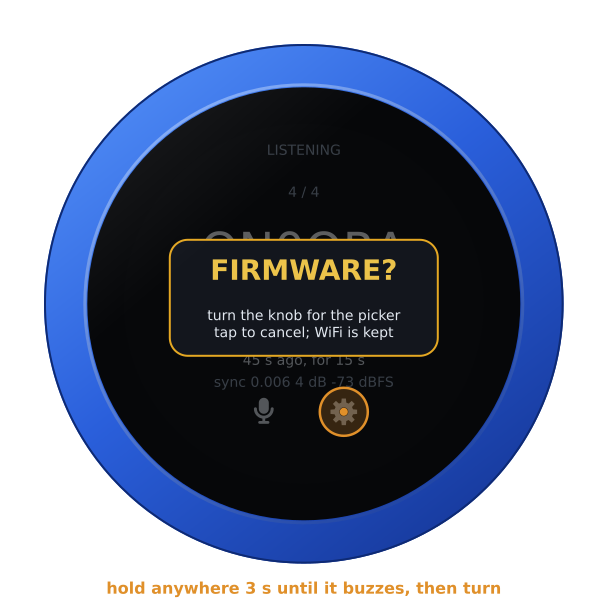

# The TailChaser Tag firmware

`vfo-knob-tctag` turns the knob into a listener that tells you **who is
talking** on a [TailChaser](https://github.com/Guru-RF/TailChaser) repeater.
A TailChaser repeater hides a faint signal under its audio, about 38 dB under
the speech: the callsign of whoever the over came from. Play the repeater
near the knob, on any radio or speaker, and the knob reads that callsign
through its own microphone and keeps a list of who was heard, one line an
over.

It is not the [TailChaser firmware](tailchaser.md), which is a remote for
TailChaser repeaters over their API. This one needs no API, no network path
to the repeater and no key: only the repeater's sound in the room. The knob
never transmits, and nothing it hears leaves it — only the callsigns read are
kept. It is a **beta**: the tag's format (v0) is TailChaser's first, and may
still change.

The pictures are the knob's own screens, drawn from the firmware's texts and
layout (`tools/mkdocs.py`); the orange marks are what your hand does.

## What it needs

- A TailChaser repeater that sends the callsign tag (tag format v0), and a
  radio or speaker that plays it near the knob.
- An SD card in the knob: the list of who was heard is kept on it, the last
  100 overs, across restarts.
- WiFi, for the configuration page, the updates and the clock. Without WiFi
  the knob still reads the tag; the list then says how long ago, not at what
  time.

Install it from the setup firmware's list (**TailChaser Tag**), or switch to
it from the configuration page.

## The face

The whole glass is the list, one over at a time, the newest first:

| Where | What |
|---|---|
| The top | **LISTENING**, or **ON THE AIR** in green while the newest over's tag is being heard |
| Under it | Where in the list you are, `4 / 4` |
| The middle | The callsign, large |
| Its pill | **LOCAL** (gold): the repeater's own input, or the repeater itself. **NETWORK**: an over from another node |
| Under that | When it came (the day too, when not today), how long ago and for how long |
| The line above the icons | The tag as the knob hears it right now: how well its frame matches, how far it stands out, its level |
| The microphone | The placement meter, below |
| Anywhere else | The address card, for the configuration page |

Just started, nobody heard yet:

A new over brings the face to it and lights the screen:

**Turn the knob** to go back through the older overs, one a detent, and on
again to the newest. One that is not the newest is shown in grey:

The same callsign read again in the frames that follow is the same over. A
new line starts when the callsign changes, or when the tag has been gone for
about 10 seconds. A reading made under speech, where a wrong one can slip
through now and then, is only believed once it is read a second time (the
repeater's tail usually gives it).

## Where to put the knob

The knob hears the tag best close to the speaker, in a quiet room. **Tap the
microphone** for the placement meter:

- The large number is the level in the tag's band, in dBFS; the bar shows
  it, with the room's own noise (white mark) and the loudest of the last
  seconds (gold mark).
- Under it, what to do, in a word:

| It says | What to do |
|---|---|
| The tag is heard well | Nothing: it reads |
| A good place | Leave it there |
| Fair: a little closer | Move it a little towards the speaker |
| Closer to the speaker | Move it closer, or turn the speaker up |
| Too loud: a little further | Move it away, or turn the speaker down |
| Play the repeater near it | It hears nothing above the room |

- At the foot, how the decoder is doing: the tag's match, the readings tried,
  read and refused, and how much of a core the decoder takes.

A tap anywhere, or a turn, goes back to the list.

## The configuration page

Tap anywhere but the microphone for the address card, and browse to the
address on it:

The page's **TailChaser Tag** section shows how the listening goes and the
list of who was heard, with the time, how long and how many readings each.
**Empty the list** clears it, on the knob and on its card.

**Say who it is** (optional, off until you turn it on) speaks each new
over's callsign out loud, on the knob's jack and on a Bluetooth speaker paired
with it, in a voice made by [ElevenLabs](https://elevenlabs.io/):

- **Say each new callsign**: on or off.
- **How**: letter by letter ("O, N, six…") or phonetic ("Oscar November
  six…").
- **Voice**: the voice's ID at ElevenLabs; empty is their "George".
- **ElevenLabs key**: your own API key, from ElevenLabs' settings (API keys),
  with Text to Speech allowed. The knob keeps it on its card; the page only
  shows whether one is set, and **Forget the key** removes it.
- **Try it**: say a callsign now.

What goes to ElevenLabs is the callsign as text, and the voice — once per
callsign: the knob keeps the spoken clip on its card and plays it from there
the next time.

## Back to another firmware

Hold a finger anywhere for 3 seconds until it buzzes, then turn the knob for
the firmware picker:

## Kept

On the SD card: the list (the last 100 overs), the speech settings and key,
and the spoken clips (`VFO-TTS/`). Nothing it hears is recorded.
