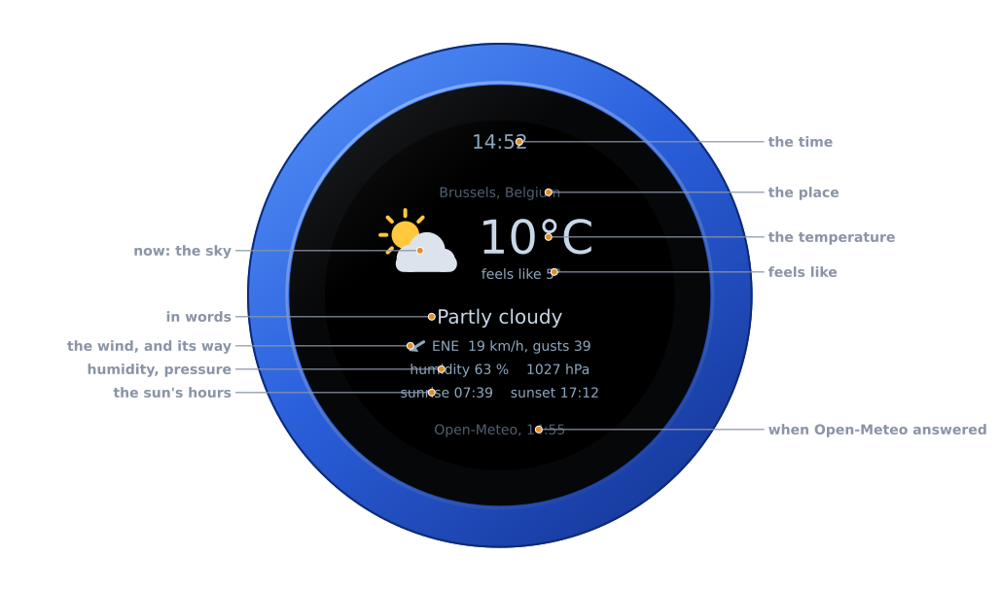
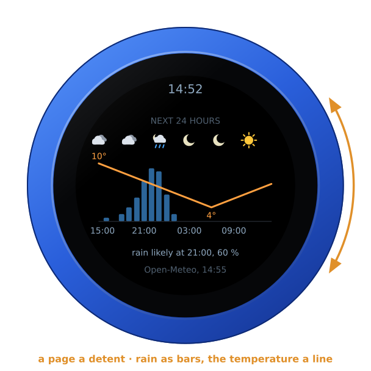
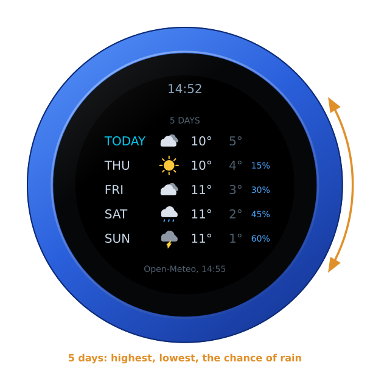
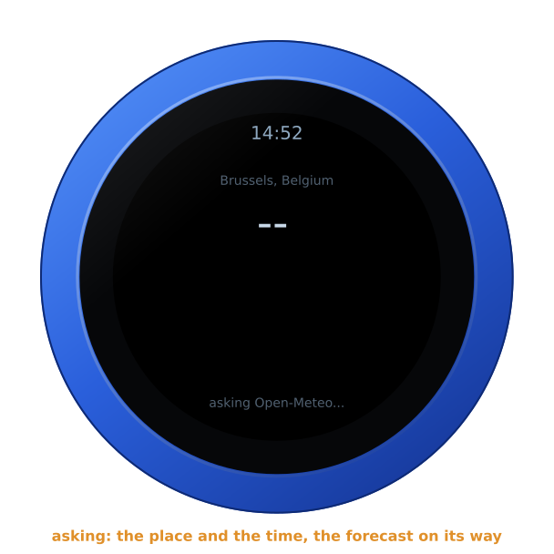
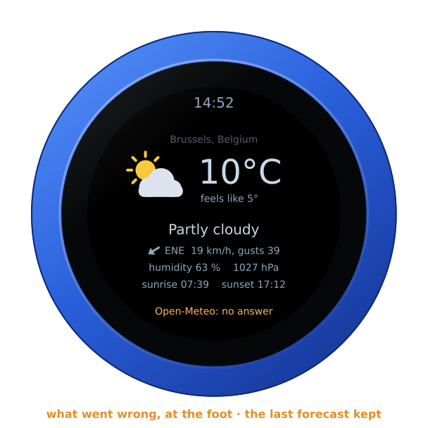
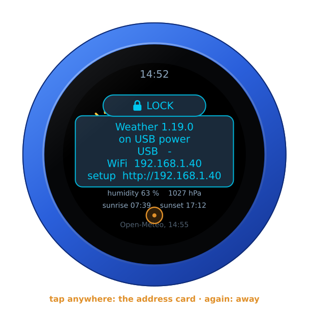
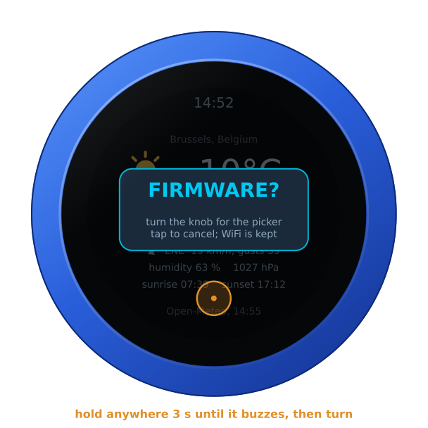
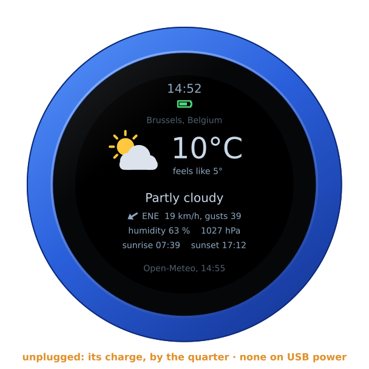
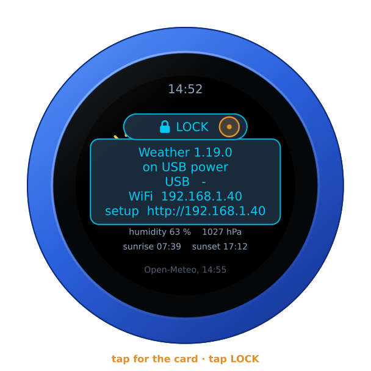
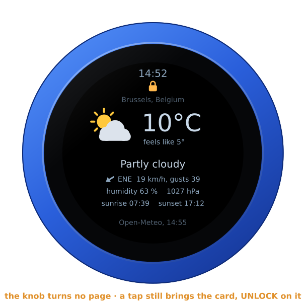

# The Weather firmware

`vfo-knob-weather` turns the knob into a weather station for one place: the
weather now, the next 24 hours and the next 5 days, from
[Open-Meteo](https://open-meteo.com/)'s forecast. The pages roll on by
themselves, every 5 seconds until set, and the dial turns them too.
It needs WiFi and nothing else: no radio, no key, no account.

The pictures are the knob's own screens, drawn from the firmware's texts,
icons and layout (`tools/mkdocs.py`); the orange marks are what your hand
does.

## First run

Install it from the setup firmware's list (**Weather**), or under
**Firmware** on any firmware's configuration page — see
[the setup guide](setup.md).

Open the knob's configuration page: tap the glass for the address card, and
browse to the address on it. The user is `admin` and the password `admin`.
The page first asks for a password of the knob's own, 8 to 32 characters,
and shows nothing else until it has one. Under **Weather**:

- **Where**: type a town or a city and press **Find**. The page lists the
  places of that name, with their region and country; **Here** on one takes
  it. The browser asks Open-Meteo for the list, not the knob, so the page
  needs the internet for this.
- **…or a place**: a latitude and a longitude in degrees, north and east
  positive — your station's, say.
- **…or a locator**: a Maidenhead locator of 4, 6 or 8 characters, `JO20eu`;
  the forecast is for the middle of its square.
- **Temperatures in**: °C or °F.
- **Wind in**: km/h, m/s, knots, mph or Beaufort.
- **Asked every**: how often the knob asks for a new forecast, 10 to 60
  minutes, 15 until set.
- **A page every**: how long each page stays before the next rolls in, 1 to
  60 seconds, 5 until set; 0 for never, when only the dial turns them.

Left empty, the place is Brussels. **Save**: the knob asks Open-Meteo at
once, and the page says when the last forecast came, or what went wrong.

The face writes the place's name in plain letters: Liège shows as Liege.

The page has no audio and no Bluetooth for this firmware: the knob plays
nothing here.

## Now

| Part | |
|---|---|
| **The time** | the knob's own, in the zone set under **Screen** |
| **The place** | as the page found it; a long name is cut short with dots |
| **The sky** | an icon for the weather now, the moon instead of the sun at night |
| **The temperature** | and what it feels like, with the wind and the damp |
| **In words** | Partly cloudy, Light rain, Thunderstorm… |
| **The wind** | where it comes from, its speed and its gusts; the arrow shows the way it blows |
| **Humidity, pressure** | in % and hPa |
| **The sun's hours** | sunrise and sunset today, at the place |
| **The foot** | **Open-Meteo**, and the time of the forecast |

There is no PTT, and no swipe does anything: the whole glass is the
weather's.

## The next 24 hours

The pages roll on by themselves: every 5 seconds until set on the page, the
one up slides out to the left and the next comes in from the right, round
and round. Under a screensaver, or dark, they wait, and the page that comes
back has its full time.

Turn the knob: the next page, a detent each, rolling the way you turn — out
to the left forward, to the right back. The count then starts again, so the
page you turned to stays its full time. Once the dial has rested for 0.6 s
the page is kept, and the knob starts on it after a restart; the pages'
own rolling never changes that.

The chance of rain each hour as blue bars, the temperature as an orange line
over them, with its highest and lowest. An icon every four hours above, the
hour every six under, in the place's own time. Under the chart, the first
hour rain is likely (50 % or more), or else the first it may come (20 % or
more), or **no rain likely**.

## The next 5 days

A row a day, today first: the icon for the day, its highest and lowest
temperature, and its greatest chance of rain where it is 10 % or more.

## When there is no forecast

Before the first forecast comes, the page has the place and the time, and
the foot says **asking Open-Meteo...**:

If Open-Meteo does not answer, the knob keeps the last forecast and says why
at the foot — **no answer**, **no WiFi**, **HTTP 429** — and asks again
after 15 seconds, then less and less often, up to the time set on the page.

A forecast more than three hours old is no forecast: the knob then says
**NO FORECAST** over the face, with its addresses, until one comes. So it
does when the first forecast has not come a minute after the knob began to
ask.

So that nothing stands still on the screen for days, the whole face moves a
pixel every three minutes, round a small square. You will not see it.

## Brightness and the screensaver

The Weather is a screen to look at, so it has no screensaver and never goes
dark until you set one on the page — see
[the screensaver guide](screensaver.md). **Brightness** on the page sets how
bright it is, 80 % until set.

## The address card

**Tap anywhere** on the glass: the address card, with the firmware and its
version, the knob's power, and its addresses for the configuration page.
Tap again, or wait ten seconds, and it goes.

**Hold anywhere for three seconds**, until the knob buzzes: it asks
**FIRMWARE?**. Turn the knob for yes, and it restarts into the setup
firmware's list, to install another firmware. A tap, or ten seconds of
nothing, says no.

## On its own battery

Unplugged, the knob shows its charge under the time, as a phone does: full
to empty by the quarter, green from half its charge up, yellow under that,
red at a fifth and below. On USB power the charge cannot be read, and none
shows. The address card says which: **battery 85 %**, or **on USB power**.

## The lock

The address card carries **LOCK**, as on every firmware: tap it, and the
knob is locked.

Locked, the padlock shows under the time, and the dial turns no page. A tap
still brings the card, with **UNLOCK** on it. A restart unlocks the knob too.

## Where it comes from

Weather data by [Open-Meteo.com](https://open-meteo.com/), under
[CC BY 4.0](https://creativecommons.org/licenses/by/4.0/). Open-Meteo is
free, without a key, for use that is not commercial; the knob asks it for one
place, every 10 minutes at the most. The place names come from Open-Meteo's
geocoding, from GeoNames. The icons are drawn by the knob's own code. The
idea of a weather face is after Yumo's
[Smart Cube](https://github.com/yumobuilds/Yumo-Smart-Cube); none of its code
is in the firmware.
