# The WiFi Test firmware

`vfo-knob-wifitest` is no radio. It measures the WiFi network the knob is
on. It records the signal, and every drop with the reason the access point
gave. It records how the router, your radio or its computer, and the
internet answer, and which other networks are near it on 2.4 GHz.

It is for a knob whose link to the radio drops. Leave it for an hour or more
where the knob is when the links drop. It then says in a few words what is
wrong, or that the WiFi looks fine and the trouble is elsewhere. Its report
goes into a problem report as it is.

The pictures are the knob's own screens, drawn from the firmware's texts,
charts and layout (`tools/mkdocs.py`). The orange marks are what your hand
does.

## First run

Install it from the setup firmware's list (**WiFi Test**), or under
**Firmware** on any firmware's configuration page. See
[the setup guide](setup.md). It joins the network the knob already knows and
starts measuring at once. It needs nothing else.

Your radio's firmware and its settings stay as they were. Go back to it the
same way when you are done: see [Back to your radio](#back-to-your-radio).

Put the knob where it is when the links drop, on its own battery or a USB
charger. The WiFi is what is being measured; a USB cable only powers the knob
here.

Open the knob's configuration page: tap the glass for the address card, and
browse to the address on it. The user is `admin` and the password `admin`.
The page first asks for a password of the knob's own, 8 to 32 characters,
and shows nothing else until it has one.

Under **WiFi Test**, **Hosts to ping** takes up to three:

- a radio, or the computer it talks to (AetherSDR's, Zeus SDR's);
- by its name or its address: `IC-705.local`, `x6100.local`,
  `192.168.1.20`.

At its first start the WiFi Test takes the hosts from the knob's other
firmwares: the radios and computers they were set up for. The line under the
fields names them.

A name ending in `.local` is found with mDNS, any other with DNS. Each is
looked up again every minute.

**Save the hosts**, and they are pinged at once. Leave all three empty to
ping only the router and the internet.

A computer whose firewall refuses pings says **no answer**. Windows does
this unless told otherwise. That is no fault of the WiFi.

The page has no audio and no Bluetooth for this firmware: the knob plays
nothing here.

## The signal

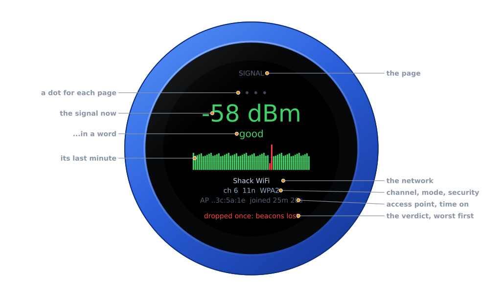

| Part | |
|---|---|
| **The page** | **SIGNAL**, **PINGS**, **DROPS** or **CHANNELS**, with a dot for each under it; this page's dot is lit |
| **The signal now** | in dBm: green from -65 up, amber down to -75, red below that |
| **In a word** | **excellent** from -55, **good** from -65, **fair** from -72, **weak** from -80, **poor** below |
| **Its last minute** | a bar a second, taller for a stronger signal, in its colour. A whole red bar is a second off the network. The two lines are -65 and -75 |
| **The network** | its name |
| **Channel, mode, security** | its channel (with **+** when 40 MHz wide), 11b, 11g or 11n, and WPA2, WPA3… |
| **Access point, time on** | the last three bytes of the access point's address, and how long the knob has been joined this time |
| **The verdict** | what it all comes to, the worst thing first, in green, amber or red. See [The verdict](#the-verdict) |

There is no PTT, and swipes do nothing: the whole glass is the test's.

## The pings

Turn the knob for the next page, one detent each, round and round.

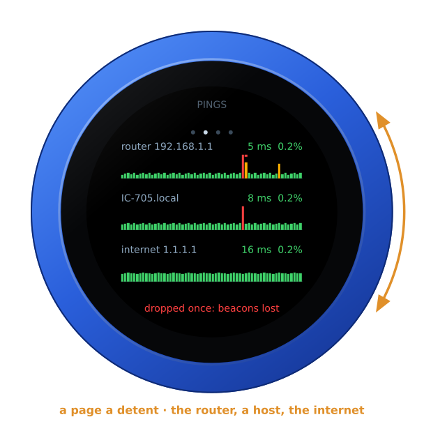

Each row is one target:

- **The router**: pinged five times a second.
- **The first host**: pinged five times a second. The page lists every host;
  the face has room for one.
- **The internet**: 1.1.1.1, pinged once a second.

Each row gives the mean answer time and the share of pings lost:

- green;
- amber from 1 % lost, or a mean over 100 ms;
- red from 5 % lost.

Under each row is its last minute, a bar a second:

- **The bar's height** is the slowest answer that second, on a scale of tens
  (1, 10, 100, 1000 ms).
- **Amber**: slower than 100 ms, which a radio's audio would hear.
- **A red cap**: some pings went unanswered that second. An answer not back
  within a second counts as lost.
- **A whole red bar**: none came back.

Instead of the numbers, a row can say:

- **looking up**: its name is not found yet;
- **not found**: its name is found nowhere;
- **no answer**: it is pinged, and nothing ever came back.

With no host set, the row says so:

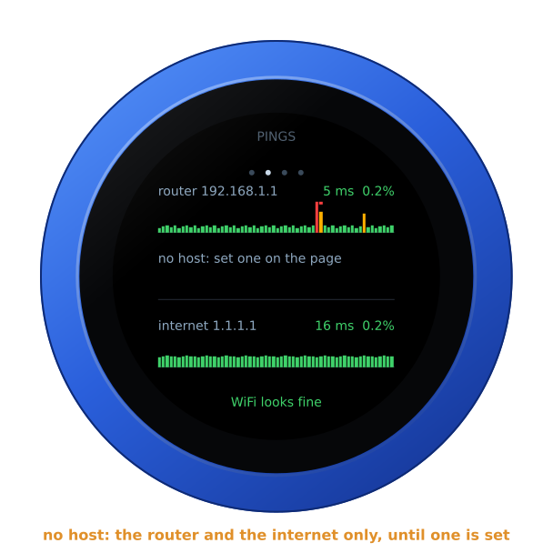

## The drops

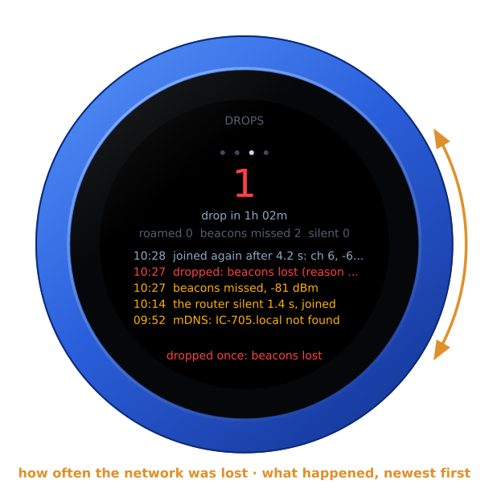

At the top is how often the network was lost: green at none, red from one.
Under that is how long the knob has measured. The next line counts:

- **roamed**: how often it joined again through another access point of the
  same network;
- **beacons missed**: how often it lost the access point's beacons for a
  while, without being dropped;
- **silent**: how often the router answered nothing for over a second while
  the knob stayed joined.

Then the five newest events, each with its time. Drops are red, joins
grey-blue, and the rest amber:

| Event | |
|---|---|
| **joined** | the network, its channel and the signal; **joined again after 4.2 s** after a drop |
| **dropped** | the reason the access point or the knob's WiFi gave, its number, and the signal then |
| **through another AP** | joined again through another access point, a roam |
| **beacons missed** | the access point unheard for a while, and the signal then |
| **the router silent** | how long, while the knob stayed joined |
| **a new address**, **the address lost** | the router's DHCP gave another address, or none |
| **not found** | a host's name, by DNS or mDNS; **found again** once it is back |

## The channels

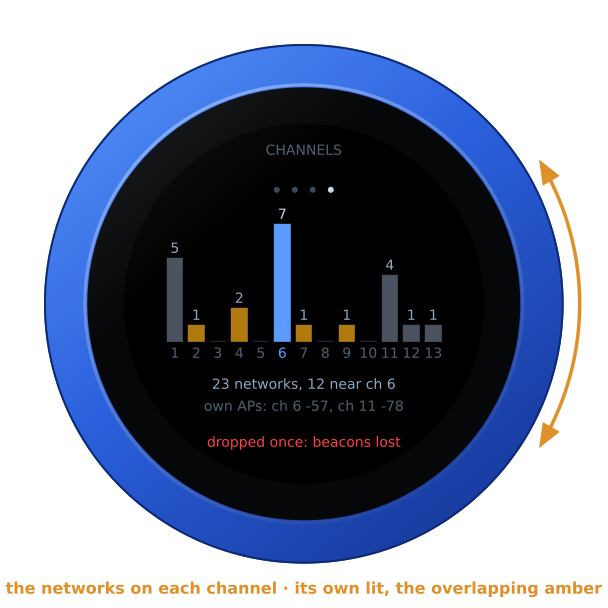

This page shows 2.4 GHz channels 1 to 13. Each has a bar for the networks
heard on it at the last scan:

- the knob's own channel is lit blue;
- the channels it overlaps are amber. Channels less than 5 apart overlap, so
  1, 6 and 11 do not.

Under the bars is how many networks were heard, and how many near its
channel. Then come its own network's access points that were heard, by
channel and dBm.

When it scans:

- 8 seconds after it joins;
- then every half hour;
- whenever you press **Scan the channels now** on the page.

The pings rest for the second or two a scan takes. The knob has 2.4 GHz only:
a network's 5 GHz side is not heard.

## The verdict

At the foot of every page, in its colour, is the worst thing found. The list
below runs from worst to least.

**Red: what breaks a radio's link**

| On the face | |
|---|---|
| **joining WiFi...** | not on the network yet |
| **off WiFi: beacons lost** | dropped, and still off; the reason follows |
| **dropped once: beacons lost**, **dropped 3 times: …** | the network was lost; the last reason follows |
| **very weak signal, -83 dBm** | the last minute's mean is below -80 |
| **router loses 6.2 % of pings** | 5 % or more |
| **router silent 3.4 s** | the router answered nothing for 3 s or more while the knob stayed joined |

**Amber: what a radio's audio would feel**

| On the face | |
|---|---|
| **weak signal, -75 dBm** | the last minute's mean is below -72 |
| **router loses 1.3 % of pings** | 1 % or more |
| **router slow: 6.0 % late** | 5 % or more of its answers took over 100 ms |
| **router silent 1.4 s** | a second or more |
| **IC-705.local not found**, **…: no answer**, **… loses 2.5 %** | a host: its name not found, no answer at all, or 2 % or more lost |
| **no internet**, **internet loses 6.0 %** | 1.1.1.1 never answered, or 5 % or more lost |
| **beacons missed 2 times** | the access point went unheard, though the knob was not dropped |
| **crowded: 14 networks near ch 6** | 12 or more networks within 4 channels of its own |

**Green**

| On the face | |
|---|---|
| **measuring...** | the first 30 seconds |
| **WiFi looks fine** | nothing of the above |

A drop does not age away: one keeps the verdict red until
**Count from nothing** on the page, or a restart.

## What to do about it

These are the most common reasons for a drop, and what they tend to mean. The
page says the same under its verdict.

| Reason | What it tends to mean |
|---|---|
| **beacons lost** | The access point went unheard for seconds. It is too far, a wall or interference is in between, or the access point restarted or changed its channel. |
| **sent away for idling** | The access point drops stations it thinks idle. Look for an inactivity or idle timeout in the router's WiFi settings. |
| **its login expired**, **the access point left**, **access point forgot it**, **the access point ended it** | The access point ended the link itself. It may have restarted or changed its settings, or it may be steering stations between bands or access points. |
| **steered to another AP**, **roaming** | A mesh or band steering moved the knob on. The knob has 2.4 GHz only, so steering it to 5 GHz fails. Turn band steering off, or give 2.4 GHz a name of its own. |
| **access point full** | The access point has as many stations as it takes. |
| **handshake timed out**, **group key timed out** | The key exchange did not finish. The signal is weak, or the WPA3 or PMF settings are ones the knob does not agree with. WPA2 (AES) is the safe choice. |
| **wrong password?** | The password was refused. |
| **network not found** | The network was not heard at all. It is out of reach, or not on 2.4 GHz. |
| **protected frames timed out** | Protected management frames went unanswered. Set PMF to "optional", not "required". |
| **too many missed ACKs** | The access point stopped acknowledging: a weak or crowded channel. |
| **access point restarted** | The access point restarted. |

What the other findings tend to mean:

- **A weak signal**: bring the access point or the knob nearer. A wall, a
  metal case or the radio itself in between all cost signal.
- **The router losing or slow, with a good signal**: the channel is crowded
  or noisy, or the router is busy. Try another of 1, 6 and 11, the one the
  channels page shows emptiest.
- **The router fine, a host losing**: the trouble is the host's own link,
  such as a radio on WiFi too, or a computer whose WiFi sleeps. Put the host
  on a cable, or turn off its power saving.
- **The router fine, the internet losing**: the trouble is the internet
  connection, not the WiFi. It hurts SmartLink and the web receivers, not a
  radio on the LAN.
- **Nothing found, and the links still drop**: the WiFi is probably not to
  blame. Say so in your problem report, with the WiFi Test's report.

## On the configuration page

Under **WiFi Test**, refreshed every two seconds:

- **The verdict**, and under it what the reason tends to mean.
- **Measured for**, **Network**, **Signal** (now, the last minute's mean, the
  lowest and the highest), **Access point**, **Mode**, **Address** (with the
  router and the DNS server), **Drops** (with the last reason, the roams, the
  beacons missed and the new addresses), **This join**, and **Names**. Names
  is the DNS lookups and the hosts' mDNS lookups that answered or not. DNS is
  asked every minute, straight of the network's DNS server, not the knob's
  cache, so a slow one shows.
- **Pings**: each target's mean, loss, fastest and slowest, its late answers,
  its longest silence, and how many were sent.
- **What happened**: the newest twelve events, with their times.
- **The channels**: when they were last scanned, the networks on each
  channel, and each network heard, by channel, signal and name. A **\*** marks
  its own network's access points.
- **Scan the channels now**, and **Count from nothing**: every count and the
  last minute begun again, the network kept.
- **Hosts to ping**: see [First run](#first-run).
- **Report**: **Show the report**, then **Copy it**. This is all of the above
  as text, for a problem report or an e-mail. Leave the knob an hour or more
  where the links drop before you make it.

The report begins like this:

```text
VFO-Knob WiFi Test v1.26.0 -- measured for 1h 02m
verdict: POOR, dropped once: beacons lost

network: "Shack WiFi" joined, access point 02:00:00:3c:5a:1e
  channel 6 (20 MHz), 11n, WPA2, country BE
  address 192.168.1.40, router 192.168.1.1, DNS 192.168.1.1
signal: -58 dBm now (good), last minute -59, lowest -81, highest -51, mean -59
drops: 1, through another AP 0, beacons missed 2, address changed 0; this join 25m 20s, off WiFi 4s in all
  the last drop: beacons lost (reason 200)
  The access point went unheard for seconds: too far, a wall or interference in between, or the access point restarted or changed its channel.
```

It goes on with the pings, the names, the networks heard and the events. A
problem report on GitHub is public. The report names your network, its access
points, and the networks round it. Read it before you send it, and take out
anything you would rather keep to yourself.

## Joining, and off the network

Just started, before the network is joined, each second off it is a red bar,
and the foot says **joining WiFi...**:

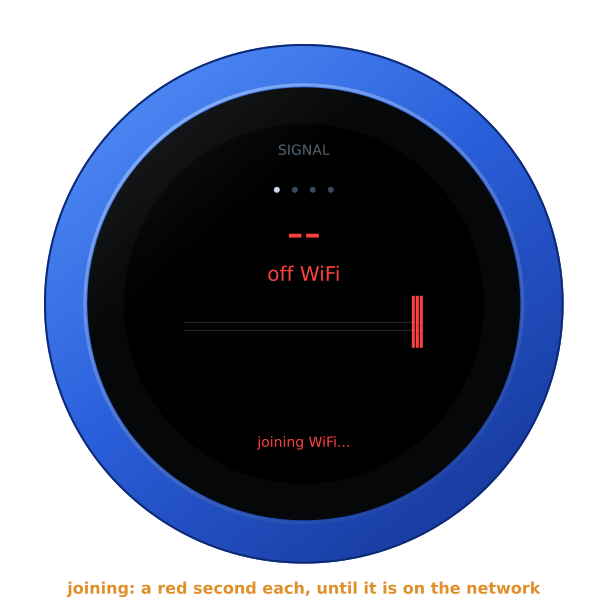

Dropped, the face says **off WiFi** and the foot gives the reason, in red. The
counting goes on, and the time off the network is added up:

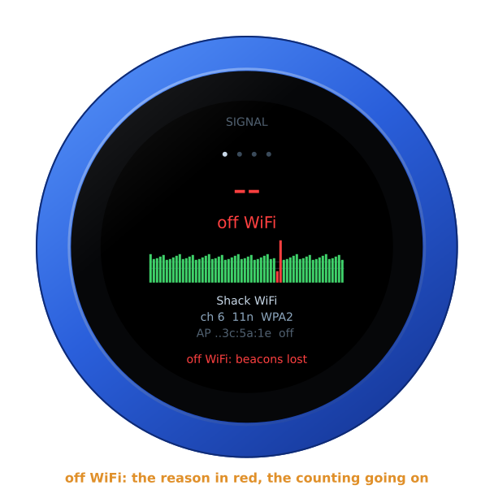

With nothing wrong found, the foot is green:

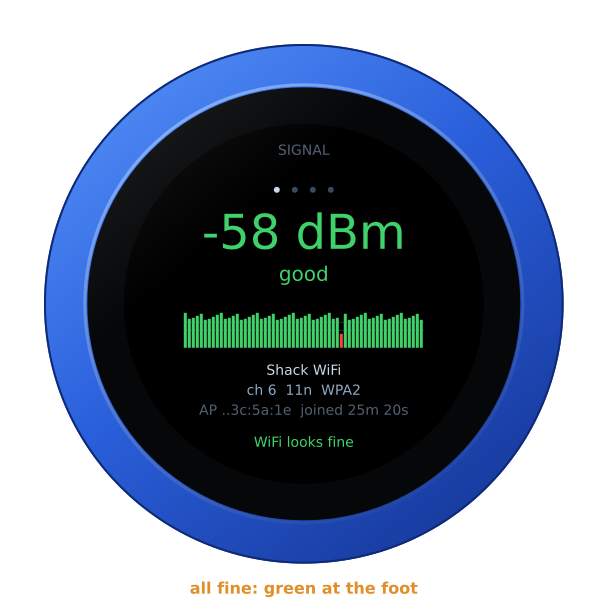

So that nothing stands still on the screen for days, the whole face moves a
pixel every three minutes, round a small square. You will not see it.

## Brightness and the screensaver

The WiFi Test is a screen to look at, so it has no screensaver and never goes
dark until you set one on the page. See
[the screensaver guide](screensaver.md). **Brightness** on the page sets how
bright it is: 80 % until set.

## The address card

**Tap anywhere** on the glass for the address card. It gives the firmware and
its version, the knob's power, and its addresses for the configuration page.
Tap again, or wait ten seconds, and it goes.

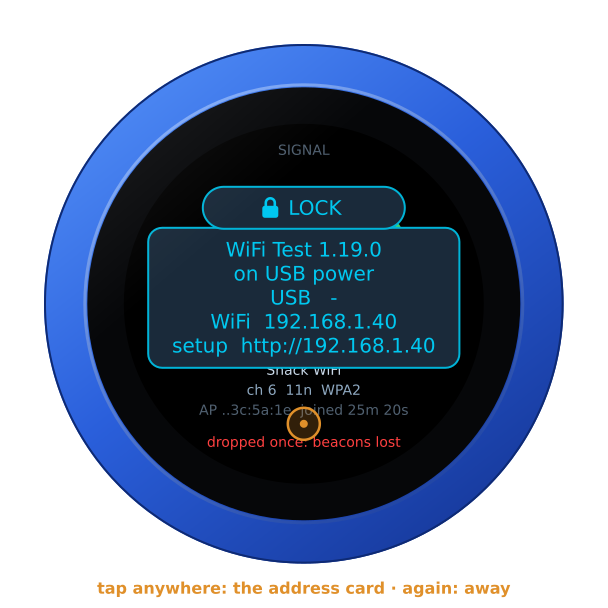

**Hold anywhere for three seconds**, until the knob buzzes, and it asks
**FIRMWARE?**. Turn the knob for yes, and it restarts into the setup
firmware's list, to install another firmware. A tap, or ten seconds of
nothing, says no.

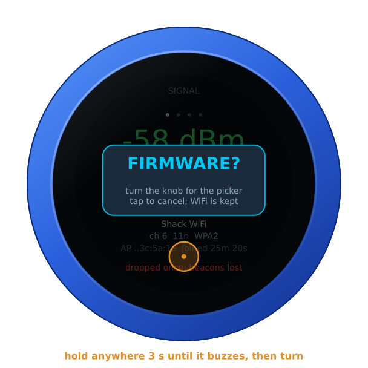

## On its own battery

Unplugged, the knob shows its charge under the page's name, as a phone does.
It goes from full to empty by the quarter: green from half its charge up,
yellow under that, red at a fifth and below. On USB power the charge cannot
be read, and none shows. The address card says which: **battery 85 %**, or
**on USB power**.

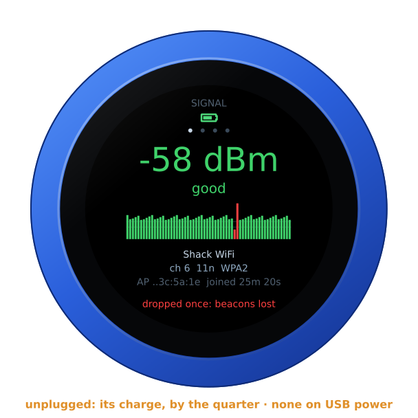

## The lock

The address card carries **LOCK**, as on every firmware. Tap it, and the knob
is locked.

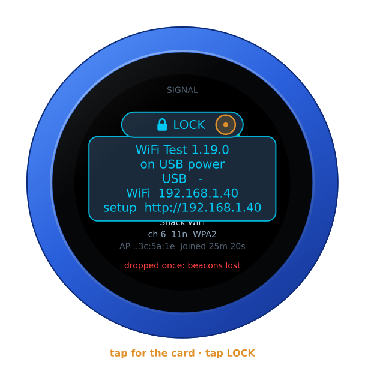

Locked, the padlock shows under the page's name, and the dial turns no page.
A tap still brings the card, with **UNLOCK** on it. A restart unlocks the
knob too.

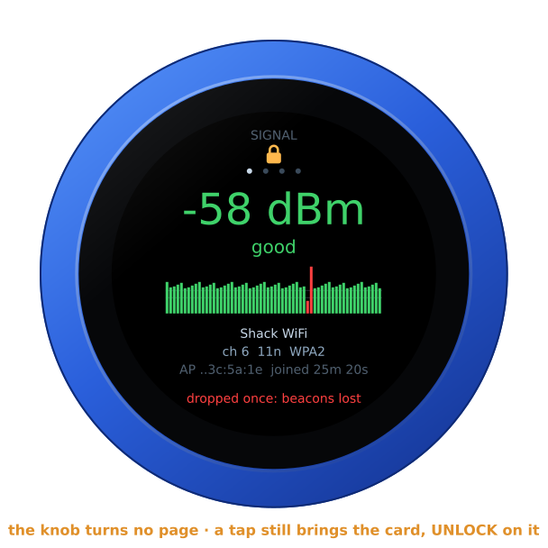

## Back to your radio

When you are done, install your radio's firmware again. Use **Firmware** on
the configuration page, or hold the glass three seconds for the setup
firmware's list. Its settings (the radio, its address, its login) are as you
left them. The WiFi Test keeps its hosts in settings of its own, and never
writes another firmware's.

## For developers

The knob's log (`nc <the knob's address> 3333`) has a line every 30 seconds,
for a run left alone:

```text
wifitest: on -52 dBm ch 6 | gw 8/75 ms 0.1% | net 20/68 ms 0.0% | drops 0, FINE: WiFi looks fine
```

That is the signal and channel; the mean and slowest answer and the loss of
the router (`gw`), each host (`h1` to `h3`) and the internet (`net`); the
drops; and the verdict. Each event is
logged as it happens. A drop is logged with its reason's hint, and each scan
with the networks heard.
